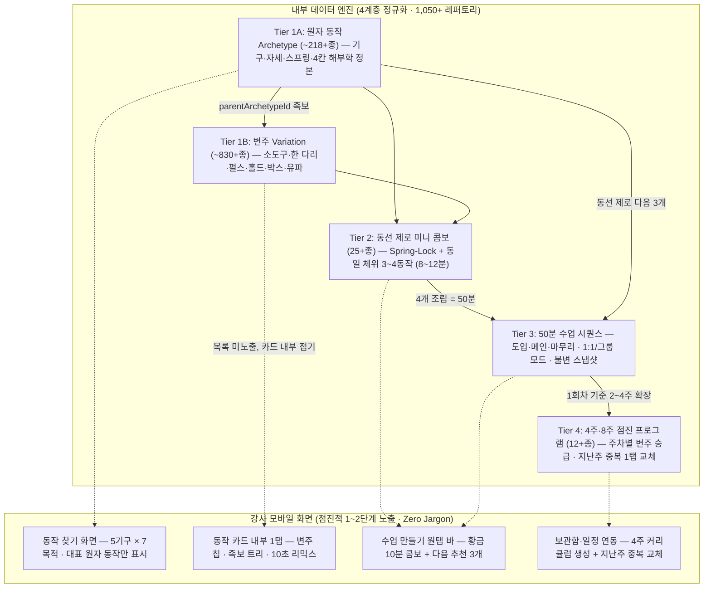
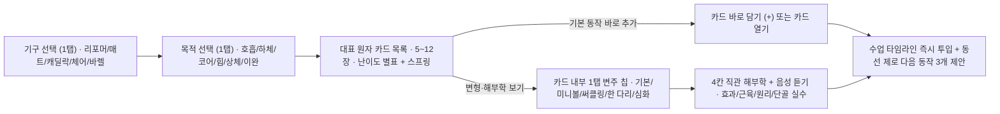
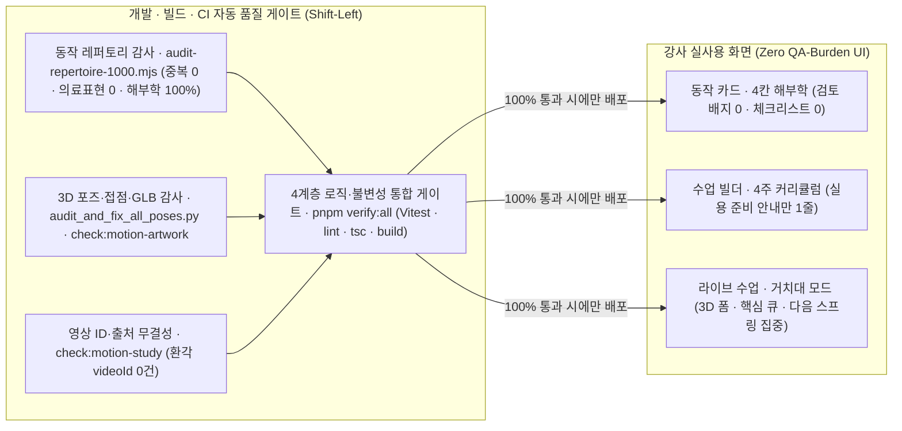

# 글로벌 필라테스 시퀀스 앱 벤치마킹 & 1,000+ 동작 4계층 조합 아키텍처 설계서

- 문서 상태: **아키텍처 설계 정본 (`Target Architecture`)** · 작성일: `2026-11-23`
- 적용 저장소: `pilates-flow-studio` (`Flow Atelier`)
- 기준 문서: [`AGENTS.md`](../AGENTS.md), [`DESIGN.md`](../DESIGN.md), [`MOVEMENT_CREATION_HIERARCHY_CONTRACT.md`](./MOVEMENT_CREATION_HIERARCHY_CONTRACT.md), [`CLASS_BLOCK_PRESETS_INTEGRATION.md`](./CLASS_BLOCK_PRESETS_INTEGRATION.md), [`competitor-usability-2026-11-16.md`](./research/competitor-usability-2026-11-16.md)

---

## 0. 핵심 요약 (Executive Summary)

1. **4계층 구조 판정 (`원자+변주 → 동선 제로 콤보 → 50분 시퀀스 → 4·8주 프로그램`)**: 글로벌 강사용 앱(Forme, Pilavio, The Class Plan, Sequence Wiz, ReformerFlow)과 4대 교육 체계(BASI, STOTT, Balanced Body, Club Pilates)를 교차 분석한 결과, **4계층 모델은 데이터·교육학·현장 운영 모두에서 최적 구조다.** 단, **데이터 저장 계층(4계층)**과 **강사 기본 화면(1~2단계 노출)**을 철저히 분리해야만 IT 비전문가 강사가 압도되지 않는다.
2. **1,000+ 동작을 200개처럼 가볍게 쓰는 IA**: 1,050개 이상 동작을 평면 목록으로 펼치면 검색 피로가 즉시 발생한다. 기본 목록은 **5개 기구 × 6~8개 핵심 목적/부위**로 단순화하고, 화면에는 **대표 원자 동작(Archetype)**만 보여준다. 소도구·난이도·리듬 변주는 동작 카드 안의 **1탭 변주 칩**과 **족보 트리(`더 쉽게 ← 기본 → 심화`)** 안으로 접는다.
3. **가장 강력한 차별화 계층은 Tier 2(`동선 제로 미니 콤보`)**: 기존 앱은 "동작 1개씩 15번 드래그"와 "50분 통짜 템플릿" 양극단에 쏠려 있다. 같은 자세·같은 스프링(`Spring-Lock`)으로 끊김 없이 이어지는 **3~4동작(8~12분) 황금 콤보**와 **마지막 동작 기준 '동선 제로 다음 동작 3개' 추천**을 두면, 강사는 4탭만으로 50분 수업을 조립한다.
4. **검토/검증 UI 강사 화면 완전 제거 (`Shift-Left QA`)**: 현재 코드베이스의 `MovementVisualGuideCard.tsx`(2,436줄), `ExtendedMotionVerificationPanel.tsx`(678줄), `MotionDraftReviewWorksheet.tsx`(287줄) 등에 흩어진 `"미검토"`, `"전문가 검토 0"`, `"검토 전/후 체크리스트"`, `"SHA-256 출처 원장"` UI는 강사 화면에서 완전히 걷어낸다. 모든 데이터·3D 폼·안전 문구 검증은 빌드·CI 자동 게이트(`audit-repertoire-1000.mjs`, `audit_and_fix_all_poses.py`, `pnpm verify:all`)로 이전한다.
5. **근거의 정직한 구분**: 본 문서는 외부 서비스의 **공식 공개 문서·기능 설명**(`공개 조사`), `pilates-flow` 저장소 코드의 **정적 실측**(`현재 구현 · Current`), 그리고 이를 종합한 **설계 목표**(`향후 목표 · Target`)를 엄격히 분리해 기록한다.

---

## 1. 조사 범위와 근거 구분

| 근거 유형 | 의미 | 본 문서 적용 범위 |
| --- | --- | --- |
| **공식 문서·공개 페이지 관찰** | 각 서비스 공식 웹사이트, 도움말, 앱스토어 소개 문구에서 확인한 구조와 기능 명세 | 글로벌 11개 앱·체계 비교표, 출처 원장 |
| **로컬 코드 실측 (`Current`)** | `2026-11-23` 기준 `pilates-flow` 저장소의 실제 소스·데이터·컴포넌트 확인 결과 | 기존 218종 동작, 20종 블록 프리셋, 검토 UI 잔존 현황 |
| **아키텍처 설계 제안 (`Target`)** | 벤치마크와 필라테스 교육학을 바탕으로 설계한 목표 구조와 UX 기준 | 1,050+ 4계층 엔진, 모바일 IA, Shift-Left 품질 게이트 |

> [!NOTE]
> 외부 앱의 유료 로그인 내부 화면을 크롤링하거나 클릭 시간·만족도를 임의로 추정하지 않았다. 수치와 기능은 공식 공개 설명으로 확인된 범위만 인용한다.

---

## 2. 글로벌 필라테스 앱·교육 체계 11종 심층 벤치마킹

글로벌 생태계는 크게 **① 강사용 시퀀스 빌더 앱**, **② 대규모 동작·영상 라이브러리 플랫폼**, **③ 4대 필라테스 교육 체계·프랜차이즈 커리큘럼**으로 나뉜다. 세 영역은 각각 강점이 다르며, 어느 한쪽도 1,000+ 동작의 **원자-변주 계보 + 동선 제로 콤보 + 다주차 프로그램 + 한국 스튜디오 모바일 UX**를 한데 묶어내지 못했다.

### 2.1 글로벌 11개 서비스·체계 비교표

| 구분 | 서비스 / 체계 | 핵심 단위 계층 | 동작 탐색·분류 방식 | 변주·난이도 처리 | 시퀀스·프로그램 조합 방식 | 강점 / 한계 (강사 시점) |
| --- | --- | --- | --- | --- | --- | --- |
| **강사 앱** | **Forme Pilates** | 동작 → 섹션 → 수업(Flow) | 리포머 중심 라이브러리, 기구 브랜드별 스프링 매핑 | 레벨·시간 입력 기반 AI 플로우 생성 | 목표 시간 대비 누적 시간(`Target length with a live total`), 라이브 재생·현재/다음 스프링 안내, 인쇄 수업표 | **강점**: 브랜드별 스프링 환산, 간결한 수업 진행 뷰 **한계**: 리포머 편중, 다주차 프로그램·원자-변주 족보 약함 |
| **강사 앱** | **Pilavio** | 동작 → 블록(워밍업~쿨다운) → 수업 → 주간 일정 | Mat·Reformer·Chair·Tower 기구 × 레벨 × 근육군 (300~400+ 동작) | 동작 카드 내 수정(Modification)·점진(Progression)·스프링·횟수 제공 | AI 루틴 생성 + 수동 편집 + 주간 캘린더 드래그·드롭 + 라이브 티치 모드 | **강점**: 멀티 기구 지원, 주간 일정 연결 **한계**: 1,000+ 확장 시 변주 묶음·동선 제로 콤보 부족 |
| **강사 앱** | **The Class Plan** | 영상 동작 → 커스텀 템플릿 → 수업 → 주간 일정 | 매트·리포머·체어·캐딜락 × 레벨 × 포커스 × 근육 (수천 개 HD 영상) | 클래식·컨템포러리·다이나믹·HIIT 변형 영상 별도 수록 | 드래그·드롭 빌더, 주간 신규 완제품 템플릿, Spotify 연동 | **강점**: 방대한 영상과 빠른 템플릿 **한계**: 영상 단위 평면 목록이라 변주 계보 파악이 어려움 |
| **인접 앱 (요가)** | **Sequence Wiz** | 슈퍼포즈(원자) + 변형 → Favorite 행(미니 콤보) → 3구간 시퀀스 | 신체 부위·기능·생리 계층 기반, 스틱피겨 시각 그리드 | **"Super-pose" 아래 원클릭 변형(Adaptation) 교체** | `Prologue → Contents(행·열) → Epilogue`, 자주 쓰는 행을 `Favorite` 블록으로 저장·재사용 | **강점**: 원자-변주 원클릭 교체 & 미니 시퀀스 재사용의 모범 사례 **한계**: 요가 중심(기구·스프링·체위 전환 계산 없음) |
| **강사 앱** | **ReformerFlow / Pilates Plans** | 동작 → 시간 구간 블록 → 수업 | ReformerFlow(400~600+ 리포머 동작), Pilates Plans(테마별 수업 프레임) | 브랜드별 스프링 설정, 레벨·반복·휴식 타이머 지정 | `Arrival → Warm-up → Main/Peak → Cool-down` 카드형 블록 조립, PDF/캘린더 내보내기 | **강점**: 빈 화면 공포를 줄이는 명확한 구간 카드 **한계**: 리포머 단일 기구 특화, 다주차 진도 연계 부재 |
| **콘텐츠 플랫폼** | **Pilates Anytime** | 개별 동작 → 클래스(3,700~4,000+) → Programs / Challenges | **15종 이상 세부 기구 조합**(Reformer w/Box vs No Box 등) × 5단계 난이도 × 시간 × 강사 | 클래스 영상 내 타임스탬프 목록(`Exercise Lists`) 제공(웹 중심) | 다회차 큐레이션 `Programs` + 5~10일 `Challenges` | **강점**: 가장 방대한 다유파 레퍼토리와 프로그램 구조 **한계**: 15종 이상 기구 필터는 현장 강사 모바일 탐색에 과도하게 복잡 |
| **콘텐츠 플랫폼** | **Pilatesology** | 백과사전 동작 → 클래식 오더(Lv별) → 커스텀 플레이리스트 / 프로그램 | Mat·Reformer·Cadillac·Chair·Barrel·Ped-O-Pul 클래식 정통 분류 | `Beginner → Intermediate → Advanced` 엄격한 누적 순서, Pre-Pilates 회귀 | 조셉 필라테스 원전 순서와 스프링 전환 자체가 안무, 커스텀 플레이리스트 제공 | **강점**: 클래식 오더·전환 철학의 정본 **한계**: 한국 스튜디오의 컨템포러리·소도구 믹스 수업에 경직됨 |
| **교육 체계** | **BASI Block System** | 동작(3레벨) → **12개 기능 블록**(매트 6블록) → 60분 종합 수업 | 12블록 "파일링 시스템"(Warm-Up ~ Back Extension) | 블록 순서를 고정하고 블록 내부 동작만 `Foundational / Intermediate / Advanced`로 교체 | 한 수업 안에서 3개 이상 기구를 12블록 흐름으로 매끄럽게 순환 | **강점**: 모든 척추 평면과 근육 균형을 보장하는 검증된 뼈대 **한계**: 12개 블록 이름을 그대로 앱 필터로 노출하면 초보 강사에게 버거움 |
| **교육 체계** | **STOTT PILATES (Merrithew)** | 5대 원칙·동작 → 3티어 레퍼토리 → 체위·스프링 묶음 → Client Workout Sheet | `Essential / Intermediate / Advanced` × Mat·Reformer·Cadillac·Chair·Barrel | 중립 척추 우선, 레버 길이·지지면·컬러 스프링(Red/Blue/White) 기반 수정 | **"Stay on Your Back"(체위 묶기)** + **스프링·박스 교체 최소화** + 다회차 워크아웃 시트 추적 | **강점**: 해부학 근거, 동선 절약 원칙, 회원별 다회차 추적 **한계**: 종이 시트·영상 포털이 분리되어 모바일 즉석 조합 불편 |
| **교육 체계** | **Balanced Body** | Movement Principles → 기구별 1·2·3 모듈 → 맞춤 수업 | 원리 우선(Why → What), 특수군(산전·골다공증·허리 등) 대응 태그 | 각 기본 동작에 수정(Modifications)과 변주(Variations)를 1:1 병기 | 모듈형 조합, Allegro 2 등 가변 풋바·스프링 기반 다이나믹 전환 | **강점**: 동작 "왜 하는가"와 수정·변주의 직관적 결합 **한계**: 방대한 매뉴얼 지식을 수업 직전 10초 안에 꺼내 쓰기 어려움 |
| **프랜차이즈** | **Club Pilates** | 동작(레이어링) → 표준 4~5개 블록 → 50분 시그니처 클래스 → 레벨 사다리 | `Intro(0) → Lv 1 → Lv 1.5 → Lv 2+` 명확한 단계 승급 | 그룹 내 초보·중급·심화 동시 변형(Layering) | `Warm-up(Footwork·Bridging·Abs) → Plank → Upper/Lower → Cool-down(FIS·Roll-down)`, **꺼낸 소도구 연속 사용 규칙** | **강점**: 50분 표준 그룹 수업의 높은 재현성과 낮은 전환 손실 **한계**: 프랜차이즈 규격 중심이라 1:1 개인 맞춤 유연성 제한 |

### 2.2 공식 출처 원장 (Verified Public Sources)

| 번호 | 서비스 / 기관 | 공식 출처 URL | 확인한 공개 범위 |
| --- | --- | --- | --- |
| S1 | Forme Pilates | [https://www.formepilates.app/features](https://www.formepilates.app/features) | 라이브러리 삽입, 섹션·순서, 목표/누적 시간, 브랜드별 스프링, 수업 진행 모드, 인쇄 수업표 |
| S2 | Pilavio | [https://pilavio.com](https://pilavio.com) | 멀티 기구(Mat/Reformer/Chair/Tower) 300~400+ 동작, AI 루틴 생성, 주간 스케줄러, 라이브 티치 모드 |
| S3 | The Class Plan | [https://theclassplan.com](https://theclassplan.com) | 매트·대기구 HD 영상 라이브러리, 레벨/기구/근육 필터, 드래그·드롭 빌더, 템플릿, Spotify 연동 |
| S4 | Sequence Wiz | [https://sequencewiz.org/sequence-builder](https://sequencewiz.org/sequence-builder) | Super-pose 변형 1클릭 교체, Favorite 행 재사용 블록, Prologue/Contents/Epilogue 구조 (요가 인접 사례) |
| S5 | ReformerFlow | [https://reformerflow.app](https://reformerflow.app) | 리포머 특화 400~600+ 동작, 브랜드별 스프링 설정, 블록 기반 라이브 티치 모드 |
| S6 | Pilates Plans | [https://pilatesplans.com](https://pilatesplans.com) | 45~60분 구간 카드(Arrival·Warm-up·Main·Cool-down), 테마별 시퀀스 및 스프링·반복 기록 |
| S7 | Pilates Anytime | [https://www.pilatesanytime.com/pilates-exercises](https://www.pilatesanytime.com/pilates-exercises) | 3,700~4,000+ 클래스, 15종+ 기구 필터, 5단계 난이도, Exercise Lists, Programs & Challenges |
| S8 | Pilatesology | [https://pilatesology.com/classes/](https://pilatesology.com/classes/) · [플레이리스트 안내](https://pilatesology.com/creating-using-custom-playlists/) | 클래식 백과사전(Exercise Encyclopedia), 원전 오더·스프링, Workout/Observe 구분, 커스텀 플레이리스트 |
| S9 | BASI Pilates | [https://www.basipilates.com](https://www.basipilates.com) | Rael Isacowitz의 12개 BASI Block System(매트 6블록), Foundational/Intermediate/Advanced 체계 |
| S10 | Merrithew (STOTT PILATES) | [https://www.merrithew.com/stott-pilates](https://www.merrithew.com/stott-pilates) · [Merrithew Connect](https://www.merrithewconnect.com) | 5대 기본 원칙, Essential/Intermediate/Advanced 3티어, Client Workout Sheets, 체위·스프링 묶음 원칙 |
| S11 | Balanced Body | [https://www.pilates.com](https://www.pilates.com) | Movement Principles → Reformer 1/2/3 모듈 커리큘럼, 수정·변주 병기, 특수군 프로그래밍 |
| S12 | Club Pilates | [https://www.clubpilates.com](https://www.clubpilates.com) | 50분 Reformer Flow 표준 블록, Intro/1/1.5/2+ 레벨 사다리, 다목적 소도구 연속 사용 및 Flow 원칙 |

---

## 3. 핵심 아키텍처 해답: 4계층 조합 모델이 최적인가?

### 3.1 결론: "4계층 데이터 모델 + 점진적 1~2계층 UX 노출"이 최적이다

필라테스 1,000+ 동작을 **① 원자 동작 + 변주 모디파이어 → ② 동선 제로 미니 콤보/블록 → ③ 50분 수업 시퀀스 → ④ 4주·8주 점진 프로그램**으로 구조화하는 설계는 **글로벌 벤치마크와 필라테스 교육학 3대 축(Classical · BASI · Contemporary)을 모두 통합하는 최적 해법**이다.

단, 흔한 실패 패턴 하나를 반드시 피해야 한다. **4계층을 강사에게 "4개 메뉴로 다 배우고 순서대로 입력하라"고 강요하면 실패한다.** 기존 계약서([`MOVEMENT_CREATION_HIERARCHY_CONTRACT.md`](./MOVEMENT_CREATION_HIERARCHY_CONTRACT.md))의 *"계층 학습 강제 금지(No Upfront Hierarchy Burden)"* 원칙을 1,000+ 동작 규모로 확장해, **엔진 내부는 4계층으로 엄격히 정규화하되 강사 화면에는 지금 필요한 1~2단계만 드러내는 구조**를 채택한다.

### 3.2 교육학 3대 유파 × 4계층 매핑 검증

| 4계층 | Classical Order (Pilatesology) | BASI Block System | Contemporary Flow (STOTT · Balanced Body · Club Pilates) | `Flow Atelier` 구현 계약 (`Target`) |
| --- | --- | --- | --- | --- |
| **Tier 1 · 원자 + 변주** (`1,050+`) | 원전 매트 34 · 리포머/캐딜락/체어/바렐 정통 동작 + Pre-Pilates 회귀 | 블록 내 `Foundational / Intermediate / Advanced` 3단계 변형 | 5대 원칙 기반 중립·수정(`Modification`)·소도구 변주(`Variation`)·3단계 레이어(`Easy/Std/Hard`) | **원자 코어(Archetype ~218+)** + **변주(Variation ~830+)** 트리 (`parentArchetypeId`, `schoolTag`, `variationKind`, 4칸 직관 해부학) |
| **Tier 2 · 동선 제로 미니 콤보** (`25+` 황금 콤보) | 전환 자체가 안무인 연속 시리즈(예: `Short Box Series`, `Long Stretch Series`) | 12블록의 기능 묶음(예: `Footwork`, `Hip Work`, `Arm Work`) | **"Stay on Your Back" 체위 묶기**, **Spring-Lock(동일 스프링 유지)**, 꺼낸 박스·소도구 연속 사용 | `GOLDEN_MICRO_FLOW_COMBOS` (3~4동작 · 8~12분 · 스프링/체위 전환 0~1회) + `recommendZeroTransitionNext` (다음 동작 3개 즉시 추천) |
| **Tier 3 · 50분 수업 시퀀스** | `Beginner / Intermediate / Advanced` 누적 순서 완주 | 12블록 균형 배치 (척추 4평면 + 상·하체 통합) | `도입(예열) → 메인(근력·협응) → 마무리(감압·이완)` + 1:1/그룹 3단계 레이어링 | 50분 표준 시퀀스 + `ReusableBlock` 복사 격리(`blockInstanceDetached`) + 과거 수업 불변 스냅샷 + 1:1/그룹 모드 + 즉석 플랜 B |
| **Tier 4 · 4주·8주 점진 프로그램** | 기초 순서 숙달 후 중급·심화 동작 점진 추가 | 4주 단위 블록 내 난이도 상향 및 기구 조합 확장 | STOTT 워크아웃 시트 누적 진도 + Club Pilates `1.0 → 1.5 → 2.0` 승급 사다리 | `CURATED_MULTI_WEEK_PROGRAMS`(12종) + 1회차→2~4주차 자동 변주 생성 + **지난주 중복 동작 1탭 자동 교체** |

### 3.3 4계층 데이터 엔진 ↔ 강사 화면 노출 분리 아키텍처

### 3.4 왜 Tier 2(`동선 제로 미니 콤보`)가 현장 강사의 시간을 가장 많이 줄이는가?

현장 필라테스 강사(특히 한국 1:1 개인 / 6:1 그룹 50분 스튜디오)가 수업 준비에서 가장 힘들어하는 지점은 "동작을 몰라서"가 아니다. **① 기구 세팅·스프링·체위 전환이 꼬여서 수업 흐름이 끊기는 문제**, **② 매주 비슷한 수업을 반복하지 않으면서 50분을 채우는 피로**다.

- **원자 동작 1개씩 조립할 때**: 50분 수업에 약 10~14개 동작을 고르고, 매번 체위(`Supine → Seated → Kneeling → Standing`)와 스프링(`2R 1B → 1R → 1B`)을 머릿속으로 대조해야 한다.
- **동선 제로 미니 콤보(`Spring-Lock` + `Orientation Map`)로 조립할 때**:
  - 예: `[도입 · 수파인 2R 1B 풋워크+브릿지 12분]` + `[메인1 · 수파인 1R 1B 스트랩 코어 12분]` + `[메인2 · 닐링/스탠딩 1R 상·하체 16분]` + `[마무리 · 1B 머메이드+핏인스트랩 10분]`
  - **4번의 탭으로 50분 풀 시퀀스가 완성**되고, 전체 수업의 스프링 교체 횟수가 **3회 이하**로 자동 제어된다.
  - 기존 동작을 하나 바꿀 때도 `recommendZeroTransitionNext`가 **현재 자세·스프링을 유지하는 다음 동작 3개**와 추천 이유 한 줄(`"같은 수파인·1R 1B 유지"`)을 띄워 주므로, 강사가 스프링표를 외우지 않아도 흐름이 매끄럽다.

### 3.5 Tier 1 원자-변주 분해 규칙 (1,050+ 동작 스팸 방지 기준)

1,000+ 동작 확장은 단순 단어 조합("리포머 풋워크 A/B/C")이 아니라 **생체역학적으로 의미가 다른 실제 현장 레퍼토리**만 허용한다.

| 축 | 정의 | 예시 (리포머 브릿징 기준) | 강사 화면 노출 위치 |
| --- | --- | --- | --- |
| **원자 코어 (`atomic`)** | 기구·자세·움직임 패턴이 고유한 대표 동작 (기존 218종 + 글로벌 핵심 정본) | `리포머 숄더 브릿지 (2R · 수파인 · 입문 ★☆☆)` | 기본 동작 목록 카드 1장 |
| **소도구 변주 (`prop`)** | 내전근·고유수용성·지지 보조가 달라지는 소도구 결합 | `+ 미니볼(무릎 사이 내전 활성화)`, `+ 써클링(외전/내전)`, `+ 폼롤러` | 카드 내 1탭 변주 칩 |
| **생체역학 변주 (`biomechanical`)** | 지지면 축소·레버 변경·리듬(편측·펄스·홀드·템포) 변화 | `한 다리 테이블탑 브릿지(중급 ★★☆)`, `힐 업 & 펄스`, `캐리지 햄스트링 컬 연결` | 카드 내 족보 트리 (`더 쉽게 ← 기본 → 심화`) |
| **박스·세팅 변주 (`setup`)** | 롱박스/숏박스·점프보드·스트랩 위치·풋바 높이 변경 | `숏박스 힙 리프트`, `풋바 다운 스탠딩 런지` | 카드 내 세팅 변주 칩 |
| **유파 변주 (`school`)** | 클래식/STOTT/BASI/Balanced Body/국내 스튜디오 특화 실행 | `Classical Pelvic Lift` vs `STOTT Neutral Hip Roll` | 카드 상세 유파 태그 (`schoolTag`) |

---

## 4. IT 비전문가 강사를 위한 "1,000+ 동작인데 초간편" 정보구조(IA)

### 4.1 인지 부하 압축 공식: `1,050개 × 11필터` → `5기구 × 7목적 × 대표 카드 1장`

Pilates Anytime처럼 15종 기구 필터를 나열하거나, 기존 `ExerciseAtlasView`처럼 검색·기구·난이도·시간·소도구·부위·척추평면·검토상태·자료도구를 한 화면에 펼치면 비전문가 강사는 첫 화면에서 이탈한다. **강사가 수업 10분 전에 생각하는 질문은 딱 두 가지**다:

> 1. **"오늘 무슨 기구 수업이지?"** (`5개 기구`)
> 2. **"어느 부위·흐름 차례지?"** (`6~8개 핵심 목적`)

| 탐색 단계 | 노출 항목 | 항목 수 | 필터 후 체감 목록 수 | 모바일 UI 형태 (`390×844`) |
| --- | --- | :---: | :---: | --- |
| **1차 축: 기구** | `리포머` · `매트` · `캐딜락` · `체어` · `바렐` | **5개** | 대표 원자 동작 **35~55개** | 상단 고정 1줄 세그먼트/칩 (`44px` 터치 영역) |
| **2차 축: 목적/부위** | `전체` · `호흡·예열` · `풋워크·하체` · `코어·복부` · `힙·둔근` · `등·상체` · `옆구리·이완` | **7개** | 대표 원자 동작 **5~12개** | 1줄 가로 스크롤 칩 (`keep-all`) |
| **보조 1탭 필터** | `입문 ★☆☆` · `중급 ★★☆` · `심화 ★★★` + `소도구` | **접힘/1줄** | **2~6개** | 난이도 3칩 + 고급 필터 `
` 접기 |
| **카드 내부 확장** | 변주 칩(`미니볼`·`써클링`·`한 다리`·`펄스`·`심화`) + 족보 트리 + `10초 리믹스` | **카드 안 접기** | 해당 동작 변주 **3~8개** | 목록 길이 증가 0, 카드 탭 시 즉시 전환·담기 |

### 4.2 10개 블록 카테고리(`ClassBlockCategory`) → 7개 강사 일상 목적 칩 매핑

내부 데이터와 BASI/컨템포러리 균형 엔진은 기존 10개 `ClassBlockCategory`를 그대로 유지하되, 강사 탐색 화면에서는 일상 언어로 **7개 목적 칩**으로 묶어 노출한다.

| 강사 화면 목적 칩 (7개) | 매핑되는 내부 `ClassBlockCategory` / 태그 | 강사가 찾는 현장 의도 |
| --- | --- | --- |
| **전체** | 전 카테고리 | 선택한 기구 전체 대표 동작 훑어보기 |
| **호흡·예열** | `warmup` | 수업 시작 5분 호흡·골반·흉곽 깨우기 |
| **풋워크·하체** | `footwork`, `lower-body` | 발목·무릎 정렬, 런지·스쿠터·스탠딩 하체 |
| **코어·복부** | `core`, `plank` | 복횡근·헌드레드·시리즈 오브 파이브·플랭크 |
| **힙·둔근** | `bridging` + 둔근 주동근(`anatomyVisualZone: 'glutes'`) | 브릿지·사이드 라잉·중둔근/대둔근 집중 |
| **등·상체** | `upper-body`, `extension` | 로잉·스트랩 팔·흉추 신전·스완·어깨 안정 |
| **옆구리·이완** | `feet-in-straps`, `cooldown` + 측굴/회전(`lateral`, `rotation`) | 고관절 감압·머메이드·측굴·수업 마무리 |

### 4.3 2탭 탐색 → 카드 내 변주 선택 → 수업 투입 모바일 흐름

### 4.4 강사 모바일 IA & 화면별 제어 예산 (`DESIGN.md` 준수)

기존 하단 4탭 골격을 유지하며, 새 기능을 별도 복잡 메뉴로 쪼개지 않고 각 탭의 자연스러운 흐름 안에 흡수한다.

| 하단 탭 (모바일 4탭) | 핵심 임무 | 화면당 주요 행동 (5~7개 예산) | 4계층 노출 방식 |
| --- | --- | --- | --- |
| **1. 작성 (`수업 만들기`)** | 오늘 50분 수업 조립 | `[1:1 개인 / 그룹 토글]` · `[황금 10분 콤보 넣기]` · `[동선 제로 다음 3개]` · `[10초 변형 리믹스]` · `[지난주 중복 교체]` · `[이어폰 암기]` · `[수업 시작]` | **Tier 2(콤보) + Tier 3(시퀀스)** 중심. 1:1/그룹 전환에 따라 완화 칩·회원 소통 카드 또는 3단계 그룹 큐 시트 노출 |
| **2. 동작 (`동작 라이브러리`)** | 1,050+ 동작 탐색·학습 | `[검색]` · `[5개 기구]` · `[7개 목적]` · `[난이도 3칩]` · `[대표 카드 +담기]` · `[내 동작 1줄 메모]` | **Tier 1(원자 대표 카드)**만 노출. 변주·족보 트리·4칸 해부학·강사 음성은 카드 내부로 접음 |
| **3. 저장 (`보관함·프로그램`)** | 저장 수업 & 4·8주 커리큘럼 | `[내 저장 수업]` · `[4주·8주 프로그램 12종]` · `[1회차→4주 자동 생성]` · `[재사용 블록]` | **Tier 3(보관 수업) + Tier 4(프로그램)** 관리. 편집 시 원본 불변 복사본 격리 |
| **4. 일정 (`수업 일정·기록`)** | 주간 반별 배정 & 이력 | `[주간 일정표]` · `[반별 직전 수업 확인]` · `[수업 진행 기록]` · `[회원 1장 리캡 공유]` | 지난주 반별 이력과 연동해 `지난주 중복 동작 1탭 교체` 및 1:1 회원 소통 카드 생성 |
| **전용 풀스크린 (`라이브 수업 진행`)** | 수업 중 거치대 진행 | `[거치대 뷰(Stand Mode)]` · `[이전/다음]` · `[즉석 플랜 B 1탭]` · `[음성 큐/호흡 페이서]` · `[정렬 카메라 보조]` | **큰 글자 + 3D 폼 + 핵심 큐 1줄 + 다음 스프링**만 초집중 노출 |

### 4.5 동작 카드 상세: "전문 용어 0, 10초 이해" 4칸 직관 해부학 + 기초 지식 구조

초보 강사나 IT 비전문가도 동작을 열자마자 "이 동작을 왜 하고, 어디에 힘이 들어가며, 회원님이 뭘 자주 틀리는지" 바로 말할 수 있도록 카드 상세를 고정 4칸으로 표준화한다.

1. **이 동작으로 좋아지는 점**: 운동·움직임 중심 효과 2~3줄 *(의학적 치료·진단·교정 보장 문구 원천 배제)*
2. **힘 들어가는 근육 지도**: 주동근(메인 힘) / 안정근(버티는 힘) 구분 + 6대 부위 해부학 일러스트(`/images/atelier-anatomy/anatomy-*.webp`)
3. **기초 원리 & 스프링 역학**: 스프링이 **보조인지 저항인지 1줄** + 호흡 리듬 + 시작 자세 기초 팁 (4대 기초 원리 화보 `/images/atelier-fundamentals/fundamental-*.webp` 연동)
4. **회원님 단골 실수 & 바로 고치는 한 마디**: 실수 패턴 2건 + 현장에서 그대로 읽는 구어체 교정 큐 2개 + **강사 음성으로 듣기** 버튼

---

## 5. 검토/검증 UI 강사 화면 완전 제거 & 빌드/개발 자동 검증 이전 정책

### 5.1 현황 진단 (`Current` 코드베이스 실측)

저장소 정적 감사 결과, 현재 강사가 매일 사용하는 6개 핵심 화면(관련 컴포넌트 총 **9,908줄**)에 개발·연구·QA 단계의 내부 검토 UI가 직접 노출되어 있다.

| 현재 파일 (`Current`) | 파일 규모 | 강사 화면에 노출 중인 개발자/QA 문구 및 위젯 | 강사 UX 저해 요인 |
| --- | ---: | --- | --- |
| `src/components/MovementVisualGuideCard.tsx` | 2,436 LOC | `[검토 전]` / `[검토 후]` 배지, `"신뢰 출처 대조 · 제작 권리 · 검토 전/후 구분 상세"`, `"4) 검토 전 → 검토 후 전환 체크리스트"`, `factualRecordSha256` | 동작 3D/도해를 보려는 강사에게 개발 감사 체크리스트와 해시 존재 여부를 노출 |
| `src/components/ExerciseAtlasView.tsx` | 4,089 LOC | `"전문가 검토 전"`, `"개인 검토 전 · 직접 추가 가능"`, `exercises.filter(isExerciseAutoEligible).length` 집계 배너 | 1,000+ 동작을 탐색할 때 미완성/미승인 자료처럼 보이게 해 신뢰 저하 |
| `src/components/InlineExerciseFinder.tsx` | 1,302 LOC | `"검토 전"`, `"정보 변경 · 다시 검토 필요"`, `"직접 입력된 태그 기준입니다. 미검토 분류도 포함합니다."` | 수업 조립 중 빠른 동작 검색 흐름을 경고 배지로 끊음 |
| `src/components/StepBlockInspector.tsx` | 1,116 LOC | `"도해 연결 · 교차 검증 완료"`, `"내 검토 기록 · 교차 검증 완료"`, `"정보 변경 · 다시 검토 필요"` | 스프링·큐를 수정하는 인스펙터가 QA 승인 도구로 혼선 |
| `src/components/ExtendedMotionVerificationPanel.tsx` | 678 LOC | `"확장 모션 도해 및 출처 대조 원장"`, `sha256IntegrityVerified` 일치/불일치 상태 | 순수 개발자 출처 해시 검증 패널이 강사 UI 트리에 포함 |
| `src/components/MotionDraftReviewWorksheet.tsx` | 287 LOC | `"이 제안의 검토 자료"`, `"대조용 자료 · 정확 자산 없음 · 전문가 검토 0"`, JSON 패킷 다운로드 | 내부 리서치 워크시트가 일반 앱 UI에 노출 |
| `src/components/YouTubeClipModal.tsx` · `GlobalRepertoirePackExplorer.tsx` · `*DraftFigure.tsx` | 다수 | `"미검토 자료"`, `"전문가 검토 0인 원본 절차 도해입니다"`, `"미검토 참조 자료 · 강사 현장 확인 필수"` | 영상·동작 팩을 추가할 때마다 경고문 과잉 노출 |

### 5.2 핵심 원칙: **Shift-Left Quality Gate (강사에게 QA를 떠넘기지 않는다)**

> **정책 선언**: 동작 데이터의 정확성, 중복 없음, 스프링·자세 정합성, 3D 인체·기구 접점 무결성, 비의료 문구 준수, 유튜브 링크 실존 여부는 **개발·빌드·CI 단계에서 100% 자동 검증하고 통과한 것만 배포한다.** 강사 화면에는 "검토 필요 / 미검토 / SHA-256 / 검증됨" UI를 단 1픽셀도 노출하지 않는다.

### 5.3 강사 화면 금지 목록(Deny List) vs 허용 목록(Allow List)

| 구분 | 구체 항목 | 처리 규칙 |
| --- | --- | --- |
| **강사 화면 완전 제거 (`Deny List`)** | `"미검토"`, `"검토 전"`, `"검토 필요"`, `"다시 검토 필요"`, `"전문가 검토 0"`, `"교차 검증 완료"`, `"Pre-Review / Post-Review"`, `"검토 워크시트"`, `"출처 원장"`, `"SHA-256"`, `"AI 안전성 검증기"`, `"3D 준비도 감사"`, `"개인 검토 전"` | 기본 강사 렌더 트리에서 완전 삭제. 내부 감사 데이터(`exerciseReview.ts`, `extendedMotionVerificationCatalog.ts`)는 CLI/테스트 전용 모듈로 격리 |
| **강사 화면 허용 안내 (`Allow List`)** | ① **현장 실용 팁** (`"스프링은 스튜디오 기구 장력에 맞춰 조절해 주세요"` — 소형 중립 텍스트) ② **수업 준비 실용 사실** (`"목표 50분 / 현재 46분 · 4분 여유"`, `"편측 동작 좌·우 시간 맞춤"` — 진행 차단이 아닌 실용 도우미) ③ **온디바이스 프라이버시 1줄** (`"기기 안에서만 표시되며 서버로 전송되지 않아요"`) ④ **비의료 고지** (설정/약관 영역 1곳 고정, 동작 카드마다 반복 도배 금지) | `DESIGN.md`의 고요한 린넨·세이지 톤으로 최소 노출 |

### 5.4 빌드·CI 자동 품질 게이트 책임 매트릭스

| 검증 영역 | 기존(강사 화면 부담) | 이전 후(개발·빌드 자동 게이트) | 실패 시 조치 |
| --- | --- | --- | --- |
| **1,050+ 동작 중복·메타 완전성** | 강사가 `"미검토"` 동작을 수동 승인 | `node scripts/audit-repertoire-1000.mjs` (ID·한글/영문명 중복 0건, 해부학·스프링 역학·단골 실수 큐 100% 필수) | 빌드/PR 차단 |
| **비의료·비진단 문구 가드레일** | 워크벤치 내 `AI 안전성 검증기` 패널 노출 | `audit-repertoire-1000.mjs` + `inspectUnverifiedHealthOrRehabClaims` 단위 테스트 자동 전수 검사 | 빌드/PR 차단 |
| **3D 포즈 접점·충돌·소도구 위치** | 강사 카드에 `"원본 초안 · 검토 0"` 경고 표시 | `scripts/blender/audit_and_fix_all_poses.py` (654포즈 바닥/기구 관통 0건, 미니볼 무릎 사이 정위치) + `pnpm check:motion-artwork` | 렌더/빌드 차단 |
| **유튜브 영상 ID 실존성** | 동작 카드에 출처 원장·SHA-256 표시 | `pnpm check:motion-study` + 카탈로그 JSON 화이트리스트 교차 검증(임의 생성 ID 0건) | 빌드/PR 차단 |
| **4계층 콤보·프로그램 무결성** | 런타임 경고 배지 다중 노출 | `composableHierarchyEngine.test.ts` + `classBlockPresets.test.ts` (참조 ID 100%, 좌우 균형, 시간 합산, 스냅샷 불변) | `pnpm verify:all` 차단 |
| **시크릿·개인정보 보호** | 수동 확인 의존 | `pnpm check:secrets` + 비식별 별칭 스키마 검증 (`VITE_` 비밀키 0건, PHI/PII 0건) | CI/배포 차단 |

---

## 6. 현재 구현(`Current`) vs 목표 아키텍처(`Target`) 정합 매핑

스웜 병렬 트랙과 기존 저장소 자산이 충돌 없이 하나로 합쳐지도록 `Current`와 `Target`의 경계를 명시한다.

| 도메인 | 현재 구현 (`Current`, 2026-11-23 `main`) | 목표 아키텍처 (`Target`) | 담당 트랙 / 핵심 모듈 |
| --- | --- | --- | --- |
| **동작 레퍼토리 (Tier 1)** | `INITIAL_EXERCISES`(158종) + `GLOBAL_CRAWLED_REPERTOIRE_EXERCISES`(60종) = **218종** | **1,050+종** 통합 대백과 (원자 코어 218+종 + 변주 830+종, `anatomyInsight` + `getProgressionTree`) | `@repertoire-1000` `src/data/worldPilatesRepertoire1000.ts` |
| **중간 단위 콤보 & 동선 (Tier 2)** | `OFFLINE_BLOCK_PRESETS`(20종), `ReusableBlock` 계약, `transitionCostOptimizer.ts` | `GOLDEN_MICRO_FLOW_COMBOS`(25+종 동선 제로 3~4동작 콤보) + `recommendZeroTransitionNext` + `remixExerciseVariation` | `@repertoire-1000` + `@mobile-unslop-ux` `src/utils/composableHierarchyEngine.ts` |
| **수업 시퀀스 & 모드 (Tier 3)** | `OFFLINE_CLASS_PRESETS`(18종), `SequenceStudioWorkbench`, `LiveStageView` | **개인(1:1) vs 그룹(6:1)** 전용 모드, 그룹 3단계 동시 큐 시트, 회원 1장 소통 리캡 카드, **수업 중 즉석 플랜 B**, 거치대 모드 | `@lesson-mode-studio` + `@mobile-unslop-ux` `src/utils/lessonFormatEngine.ts` |
| **다주차 프로그램 (Tier 4)** | `CURATED_SEQUENCE_PROGRAMS`(8종 단회성), `CurriculumProgressionSheet`(기본 4주 생성) | `CURATED_MULTI_WEEK_PROGRAMS`(12종 4·8주) + 1회차→2~4주 자동 변주 + **지난주 중복 동작 1탭 자동 교체** | `@repertoire-1000` + `@mobile-unslop-ux` `src/utils/composableHierarchyEngine.ts` |
| **3D 시각·해부학 가이드** | 218종 640×400 저밀도 렌더, 일부 기구/소도구 관통 결함 | Blender 5.3 고밀도 풀 폴리곤 654프레임 전수 교정·재렌더 + 6종 Flagship GLB + **4칸 직관 해부학 카드** | `@model-3d-hero` + `@mobile-unslop-ux` `scripts/blender/*`, `IntuitiveAnatomyGuideCard.tsx` |
| **음성 암기 & 큐잉** | 보고서 문장 기반 브라우저 `speechSynthesis` (`koreanVoiceNarration.ts`) | 구어체 리라이트 + 멀티티어 자연 한국어 음성(Cloud Neural + IndexedDB 캐시 + On-Device Enhanced) + **출근길 이어폰 암기(이어듣기·빈칸퀴즈·호흡 페이서)** | `@voice-engine` `naturalVoiceEngine.ts`, `SequenceAudioRehearsalModal.tsx` |
| **품질 검증 UX** | 강사 화면 6+개 컴포넌트에 `"미검토 / 검토 필요 / SHA-256"` 노출 | **강사 화면 검토 UI 0건**, 전 항목 개발·빌드·CI 자동 게이트 이전 | `@mobile-unslop-ux` + `@repertoire-1000` + `@model-3d-hero` `scripts/audit-repertoire-1000.mjs`, `pnpm verify:all` |

---

## 7. 모바일 UX 검증 기준 & 설계 체크리스트 (`DESIGN.md` 연동)

통합 머지 이후 아래 6개 수용 기준을 자동 테스트와 실제 `390×844` / `320×568` 모바일 뷰포트에서 확인한다.

1. **2탭 탐색·투입 속도**: 기구 1탭 → 목적 1탭 → 대표 카드 `[+]` 1탭(또는 카드 내 변주 칩 1탭 후 담기)으로 **검색 초기화·스크롤 유실 없이** 시퀀스에 정확히 1건이 추가된다.
2. **목록 비대화 차단**: 1,050+ 동작이 탑재되어도 기본 목록은 **원자 대표 카드(기구×목적당 5~12장)**만 먼저 보여 주고, 변주는 카드 안 칩·족보 트리에서 펼친다.
3. **검토 UI 0건 회귀 테스트**: 강사 기본 화면(`작성` · `동작` · `저장` · `일정` · `라이브 진행`) 렌더링 DOM에서 `/미검토|검토 전|검토 필요|전문가 검토 0|SHA-256|출처 원장/` 문자열이 **0건**임을 자동 테스트로 고정한다.
4. **터치·조판 안전성**: 모든 주요 칩·버튼 `>= 44×44px`, 가로 스크롤 누수 `0px`, 한글 `word-break: keep-all`, 수치·스프링·시간 `tabular-nums`, 하단 스티키 바가 마지막 카드를 가리지 않도록 `safe-area-inset-bottom` 여백 확보.
5. **기존 계약 100% 하위 호환**: 기존 `INITIAL_EXERCISES`(158종) 및 `GLOBAL_CRAWLED_REPERTOIRE_EXERCISES`(60종) ID, `ReusableBlock` 편집 격리, `ClassSequenceSnapshot` 과거 수업 불변, `LiveStageView` 이탈 보호 경로를 깨뜨리지 않는다.
6. **정직한 비의료·프라이버시 경계**: 모든 1,050+ 동작 설명·해부학 효과·회원 리캡 카드는 운동·움직임 표현만 사용하며, 회원 데이터는 비식별 별칭과 기기 내 로컬 저장 원칙을 지킨다.
