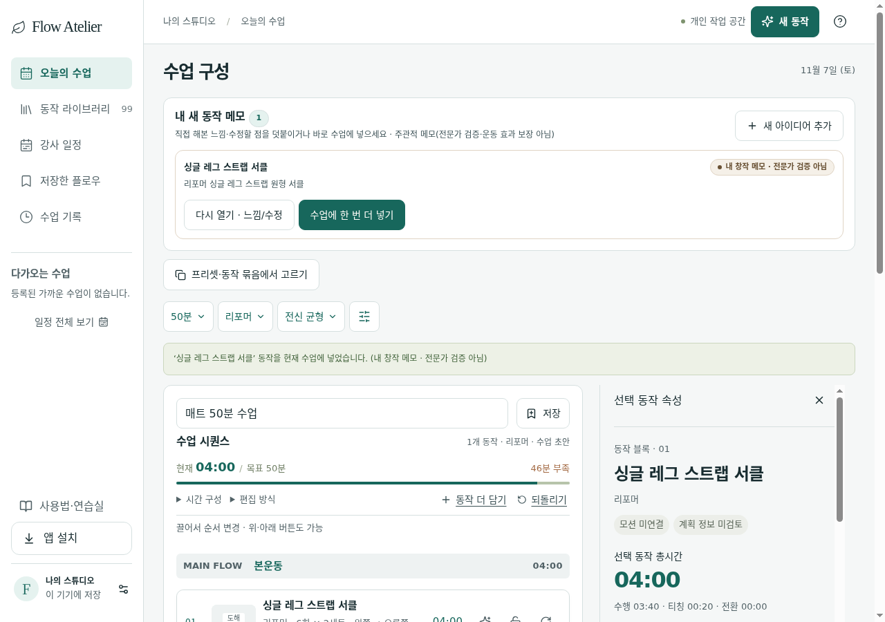

# Pilates Flow 초보 강사 사용성 및 수업 시간 시뮬레이션 3트랙 병렬 검증 종합 보고서 (2026-11-07)

- **검증 일자**: 2026-11-07
- **실행 방식**: 다이나믹 워크플로우 3트랙 병렬 (`scripts/class-flow-audit-20261107/run-all.mjs`)
- **기존 코드 보존**: 모든 기존 소스(`src/**`), 설정, 문서, 사용자 데이터는 **100% READ-ONLY**로 유지하고, 신규 경로(`scripts/class-flow-audit-20261107/**`, `docs/class-flow-audit-20261107/**`)에만 검증 코드와 증적 문서를 작성함.
- **통합 결과 요약 JSON**: [`docs/class-flow-audit-20261107/summary.json`](./summary.json)

---

## 1. 트랙별 보고서 및 실행 스크립트 구조

| 트랙 | 검증 영역 | 회귀 스크립트 | 결과 JSON | 상세 보고서 |
| --- | --- | --- | --- | --- |
| **공통 (Shared)** | 합성 Fixture & CDP 헤드리스 브라우저 하네스 | [`shared/synthetic-fixtures.mjs`](../../scripts/class-flow-audit-20261107/shared/synthetic-fixtures.mjs), [`shared/cdp-harness.mjs`](../../scripts/class-flow-audit-20261107/shared/cdp-harness.mjs) | [`summary.json`](./summary.json) | 본 문서 (`README.md`) |
| **Track A** | 작은 동작 → 중간 블록 → 시퀀스의 중첩 반복·편측·휴식·전환시간 경계값 및 시뮬레이션 검증 | [`track-a/run-track-a.mjs`](../../scripts/class-flow-audit-20261107/track-a/run-track-a.mjs) | [`track-a/results.json`](./track-a/results.json) | [`track-a/REPORT.md`](./track-a/REPORT.md) |
| **Track B** | 모바일 드래그 / 키보드 순서변경·취소·잠금 장벽·자동스크롤 및 시각 피드백 실제 브라우저 검증 | [`track-b/run-track-b.mjs`](../../scripts/class-flow-audit-20261107/track-b/run-track-b.mjs) | [`track-b/results.json`](./track-b/results.json) | [`track-b/REPORT.md`](./track-b/REPORT.md) |
| **Track C** | `320px`/`390px`/`768px`/`1440px` · `200%` 배율에서 새 동작 추가 → 조합 → 저장 → 재열기 최소 동선 및 화면 밀도 검증 | [`track-c/run-track-c.mjs`](../../scripts/class-flow-audit-20261107/track-c/run-track-c.mjs) | [`track-c/results.json`](./track-c/results.json) | [`track-c/REPORT.md`](./track-c/REPORT.md) |

### 독립 회귀 실행 명령어

```bash
# 3트랙 병렬 전체 실행 (단일 임시 Vite 서버 기동 후 트랙 A/B/C 병렬 실행 및 자동 종료)
node scripts/class-flow-audit-20261107/run-all.mjs

# 트랙별 단독 실행
node scripts/class-flow-audit-20261107/track-a/run-track-a.mjs
node scripts/class-flow-audit-20261107/track-b/run-track-b.mjs
node scripts/class-flow-audit-20261107/track-c/run-track-c.mjs
```

---

## 2. 실제 통과 (Actual Pass) vs 재현한 결함 (Reproduced Defect) vs 미검증 (Unverified) 총괄표

### 2.1 실제 통과 (Actual Pass)

| 트랙 / ID | 검증 항목 | 검증 결과 |
| --- | --- | --- |
| **Track A (`A1-01`, `A1-02`)** | 작은 동작 시간 분해(`calculateIdeaStepTimeBreakdown`) 및 최소 움직임 시간(`>= 10s`) 클램핑 | `durationMin=3, explanationSec=25, transitionSec=15` → `totalSec=180, movementSec=140`; `durationMin=0.5(30s), explanationSec=25, transitionSec=20` → `explanationSec=20, transitionSec=0, movementSec=10` 정확히 클램핑됨 |
| **Track A (`A2-01`, `A2-02`)** | 중간 블록(`ReusableBlock`) 하위 시간 합산(`summarizeReusableBlockTiming`) 및 비례 스케일링(`scaleReusableBlockDuration`) | 2개 동작(`3분` + `4분`) 합산 `420s` (`movementSec=355s, explanationSec=45s, transitionSec=20s`, `unilateralItemCount=1`), `10분(600s)` 스케일링 및 최소 하한(`1.5분`) 미만 거부 정상 동작 |
| **Track A (`A3-03`)** | 시퀀스 내 중간 블록 인스턴스 편집·스케일·복제·제거 시 원본 블록 템플릿 격리(`blockInstanceDetached`) | 시퀀스 내 블록 스텝을 `5분 / 12회`로 수정·`11분` 스케일·복제·삭제해도 원본 `ReusableBlock` 템플릿(`3분 / 8회`)은 절대 변경되지 않음 (`deepFreeze` 및 `detached=true` 확인) |
| **Track A (`A4-01`, `A4-02`)** | 별도 휴식 스텝(`kind: 'rest'`) 합산·상한 및 `calculateStepTimeEstimate` 반복·세트·호흡·세트휴식·좌우전환 계산 | 휴식 `2분(120s)`은 `restSec`에만 합산되고 `restSec >= targetMinutes` 시 `sequenceSchema`가 거부함. `calculateStepTimeEstimate`가 `movingSec(288) + restingSec(60) + switchingSec(10) + explanationSec(20) + transitionSec(15) = 393s` 및 `30s..1200s` 경계를 정확히 판정함 |
| **Track A (`A5-01`, `A6-01`)** | `buildSequenceSimulation` / `seekSequenceSimulation` / `createClassSequenceSnapshot` 및 실제 브라우저 시간 미리보기 UI | 시뮬레이션 세그먼트 합계(`movementSec + teachingSec + transitionSec + restSec === totalSec`), 휴식 구간 탐색(`seekMidRest.segment.kind === 'rest'`), 스냅샷 복제 격리, 브라우저 `MovementIdeaSheet` & `StepBlockInspector` 실시간 시간 계산 UI 정상 렌더링 |
| **Track B (`B1-01`)** | 키보드(`ArrowDown`/`ArrowUp`) 및 위로/아래 버튼 순서 변경, 포커스 유지(`#order-handle-${stepId}`), 첫/끝 경계 비활성화 | 첫 스텝 `upDisabled === true`, 마지막 스텝 `downDisabled === true`, `ArrowDown`/`ArrowUp` 시 순서 즉시 변경 및 `activeElement` 포커스 보존, 안내 배너(`"순서를 바꿨어요. 되돌릴 수 있습니다."`) 출력 |
| **Track B (`B2-01`)** | 모바일(`390×844`) 8px 드래그 임계값(`DRAG_THRESHOLD_PX = 8`), 시각 피드백(`sequence-drag-overlay`, `sequence-drop-indicator`, `data-drag-source`, `data-drag-over`), 드롭 커밋 | `+4px` 이동 시 드래그 미시작(`overlayPresentUnderThreshold: false`), `+14px` 이동 시 플로팅 오버레이·드롭 인디케이터·카드 밀림(`translate3d`) 활성화 후 `pointerup` 시 목표 위치로 정확히 커밋됨 |
| **Track B (`B3-01`)** | 드래그 중 4종 취소(`Escape`, `pointercancel`, 영역 밖 좌측 `x=4` 드롭, `blur`/`lostpointercapture`) | 4가지 취소 경로 모두에서 `activeSteps` 순서가 변경되지 않고(`orderUnchanged: true`) `.sequence-drag-overlay` 및 `.sequence-drop-indicator`가 즉시 제거됨 |
| **Track B (`B4-01`)** | 잠긴 스텝(`locked: true`) 드래그 장벽(`resolveAvailableIds`, `data-drag-blocked="true"`) | 2번 스텝 잠금 시 2번 핸들 `disabled === true`, 1번 스텝을 2번 아래로 드래그 시도 시 `data-drag-blocked="true"` 표시 및 안내 메시지(`"잠긴 항목의 위치는 유지합니다."`)와 함께 순서 변경 차단 |
| **Track B (`B5-01`)** | 모바일 뷰포트 하단 가장자리(`EDGE_ZONE_PX = 76`) 정지 상태 자동 스크롤(`requestAnimationFrame`) | 포인터를 하단 가장자리(`y = 828px`)에 고정 유지하는 동안 추가 `pointermove` 없이도 550ms 동안 `window.scrollY`가 `+140px` 연속 자동 스크롤됨 |
| **Track C (`C1-01`)** | 동일 세션 내 최소 동선(새 동작 2개 생성 → 중간 블록 묶기 → 시퀀스 복사 → 수업 저장 → 수업 보관함 재열기) | 5단계 핵심 동선이 동일 세션에서 정상 완료되며, 지연 로딩(`React.lazy`)된 `ClassBinderView`에서 저장한 수업(`초보 강사 첫 리포머 시퀀스`)을 찾아 워크벤치로 다시 열기 성공 |
| **Track C (`C2-01`)** | `320px`/`390px`/`768px`/`1440px` `100%` 배율 가로 오버플로 `0px` 및 주요 버튼 터치 타깃(`>= 44px`) | 4개 뷰포트 `100%` 배율에서 가로 스크롤 오버플로 `0px` (`scrollWidth === clientWidth`), 주요 액션 버튼 높이 `44px~46px` 충족 |

---

### 2.2 재현한 결함 (Reproduced Defects) 요약 카탈로그

| 결함 ID | 트랙 | 심각도 | 결함 요약 | 핵심 파일 및 라인 |
| --- | --- | --- | --- | --- |
| **DEF-A01** | Track A | Medium | 단일 방향 편측(`sideMode: 'left' \| 'right'`)으로 동작 저장 시 `isUnilateral: true`로 저장되어, 이후 기본 좌우 모드(`동작 기본`)에서 2방향(양쪽 교대 1/2 분할)으로 오계산됨 | [`src/utils/movementIdeaDraft.ts:875`](../../src/utils/movementIdeaDraft.ts#L875), [`src/utils/sequenceEngine.ts:393-400`](../../src/utils/sequenceEngine.ts#L393-L400) |
| **DEF-A02** | Track A | High | `repetitions > 1000` / `sets > 100` 입력 시 미처리 `ZodError` 예외 발생, 동작(`1000/100`)↔중간블록(`500/50`) 스키마 상한 불일치로 인한 블록 생성 실패, 수정 시 기존 `repetitions`/`sets` 비우기 불가 | [`src/utils/movementIdeaDraft.ts:806-830`](../../src/utils/movementIdeaDraft.ts#L806-L830), [`src/utils/humanMovementCreation.ts:96`](../../src/utils/humanMovementCreation.ts#L96), [`src/utils/hierarchyModel.ts:185-186`](../../src/utils/hierarchyModel.ts#L185-L186) |
| **DEF-A03** (`C1-02`) | Track A & C | High | 중간 블록(`ReusableBlock`)에서 `selectedLayer` 미지정 시 시퀀스 스텝의 `selectedLayer`가 `undefined`가 되어, 수업 저장 후 **새로고침 시 `stepSchema` 검증 실패로 `savedSequences` 전체가 초기 샘플로 초기화(데이터 유실)**됨 | [`src/utils/hierarchyModel.ts:845`](../../src/utils/hierarchyModel.ts#L845), [`src/utils/hierarchyModel.ts:1489`](../../src/utils/hierarchyModel.ts#L1489), [`src/schemas/cloudBackupSchema.ts:299`](../../src/schemas/cloudBackupSchema.ts#L299), [`src/store/usePilatesStore.ts:2481`](../../src/store/usePilatesStore.ts#L2481) |
| **DEF-A04** | Track A | Medium | 빈 수업(`activeSteps.length === 0`)에 첫 새 동작을 바로 넣을 때(`addMovementIdeaToCurrentClass`) 첫 동작의 전환시간이 `0초` 대신 `15초`로 덮어써짐 | [`src/utils/movementIdeaDraft.ts:1666-1680`](../../src/utils/movementIdeaDraft.ts#L1666-L1680), [`src/store/usePilatesStore.ts:1772`](../../src/store/usePilatesStore.ts#L1772) |
| **DEF-A05** | Track A | Medium | `insertIdeaReusableBlockToCurrentClass`가 `undoStack` 스냅샷 저장을 우회하여 블록 삽입 직후 되돌리기(Undo)가 불가능하며, 기존 스텝 뒤에 추가될 때 블록 첫 스텝의 `transitionSec`가 `0초`로 남음 | [`src/utils/movementIdeaDraft.ts:1503-1514`](../../src/utils/movementIdeaDraft.ts#L1503-L1514) |
| **DEF-A06** | Track A | Low | `calculateStepTimeEstimate`가 `durationMin = totalSec / 60`을 반올림 없이 반환하여 `StepBlockInspector` 총시간 입력칸에 `2.9833333333333334` 같은 17자리 무한소수가 그대로 노출됨 | [`src/utils/stepTimeEstimate.ts:42`](../../src/utils/stepTimeEstimate.ts#L42), [`src/components/StepBlockInspector.tsx:351`](../../src/components/StepBlockInspector.tsx#L351) |
| **DEF-A07** | Track A | Low | 홀수 `movementSec`(예: `51초`)의 양방향 편측 동작에서 `getStepTiming` / `buildSequenceSimulation`은 `25.5초`를 반환하는 반면 계약서(`MOVEMENT_CREATION_HIERARCHY_CONTRACT.md`)는 `Math.floor` 내림을 명시함 | [`src/utils/sequenceEngine.ts:404`](../../src/utils/sequenceEngine.ts#L404), [`src/utils/sequenceSimulation.ts:220`](../../src/utils/sequenceSimulation.ts#L220) |
| **DEF-B01** | Track B | Medium | 섹션 경계를 넘어 순서를 변경할 때 `reorderStep`이 `blockCategory`/`classSection`을 갱신하지 않아 `sectionRuns`가 `본운동 → 준비운동 → 본운동 → 마무리` 4개 블록으로 쪼개지고 중복 섹션 헤더가 생성됨 | [`src/store/usePilatesStore.ts:1660-1695`](../../src/store/usePilatesStore.ts#L1660-L1695), [`src/components/SequenceWorkbench.tsx:436-445`](../../src/components/SequenceWorkbench.tsx#L436-L445) |
| **DEF-B02** | Track B | Low | 섹션 헤더를 사이에 둔 첫 스텝 드래그 시 `sequenceDrag.ts`가 섹션 헤더 높이가 포함된 간격(`79px` vs 일반 `18px`)을 모든 카드 이동량에 적용하여, 드래그 중 하위 카드가 `-234.7px` 과도하게 위로 밀려 섹션 헤더를 침범함 | [`src/utils/sequenceDrag.ts:205-215`](../../src/utils/sequenceDrag.ts#L205-L215) |
| **DEF-C01** | Track C | Medium | 모바일(`320px`/`390px`) 화면 밀도 병목: ① 기존 수업 편집 중 새 동작이 0개일 때 `"한 줄 동작 메모"` 버튼이 화면 최하단(`y=3050px`, `3.61` 화면 아래)에만 존재함, ② 새 동작 2개 생성 후 상단 `.pf-workbench-ideas`(`588px`~`607px`)가 접히지 않아 첫 시퀀스 카드가 `y=1155px` (`+601px` 하강, `320px` 기준 `2.07` 화면) 아래로 밀려남 | [`src/components/SequenceWorkbench.tsx:660-852`](../../src/components/SequenceWorkbench.tsx#L660-L852), [`src/components/SequenceWorkbench.tsx:1158-1180`](../../src/components/SequenceWorkbench.tsx#L1158-L1180) |
| **DEF-C02** | Track C | Low | `320px` 및 `390px` 모바일 뷰포트에서 브라우저 `200%` 확대 시 최소 폭(`640px`) 고정으로 인해 각각 `320px`, `250px`의 가로 스크롤 오버플로 발생 | [`src/styles/sequence-workbench.css`](../../src/styles/sequence-workbench.css), [`src/styles/app-shell.css`](../../src/styles/app-shell.css) |

---

### 2.3 미검증 (Unverified) 경계

1. **실제 원격 클라우드 백업 서버(Supabase/외부 API) 네트워크 동기화**:
   - 무료 기존 도구만 사용하고 인증 변경·외부 배포를 금지한 원칙에 따라, 로컬 스토리지 영속성 및 `cloudBackupSchema` 파서 검증까지만 수행하였으며 외부 원격 서버 왕복은 미검증으로 분리함.
2. **실제 물리 모바일 단말의 OS 네이티브 햅틱/물리 관성 스크롤**:
   - Chromium CDP 모바일 에뮬레이션(`320×568`, `390×844`, `hasTouch: true`) 및 실제 PointerEvent/Touch 세션으로 검증 완료했으나, 물리 iOS Safari / Android Chrome 기기의 OS 레벨 제스처 충돌은 미검증으로 분리함.

---

## 3. 핵심 결함 시각 증적 및 최소 수정 제안 요약

### 3.1 [DEF-A03 / C1-02] 중간 블록 포함 수업 저장 후 새로고침 시 `savedSequences` 전체 초기화 (High)

- **원인**:
  1. [`src/utils/hierarchyModel.ts:1489`](../../src/utils/hierarchyModel.ts#L1489)의 `insertReusableBlockIntoSequence`가 `selectedLayer: item.selectedLayer`를 그대로 복사하여 `item.selectedLayer`가 생략된 블록 스텝의 `selectedLayer`가 `undefined`가 됨.
  2. [`src/schemas/cloudBackupSchema.ts:299`](../../src/schemas/cloudBackupSchema.ts#L299)의 `stepSchema`는 `selectedLayer: layerSchema`를 필수로 요구함.
  3. [`src/store/usePilatesStore.ts:2481`](../../src/store/usePilatesStore.ts#L2481)에서 `z.array(sequenceSchema).safeParse(raw.savedSequences)`가 배열 전체를 한 번에 검증하므로, 단 1개의 스텝만 실패해도 사용자가 저장한 모든 수업(`savedSequences`)이 폐기되고 초기 샘플 3개로 리셋됨.
- **최소 수정 제안**:
  - `createReusableBlock` 및 `insertReusableBlockIntoSequence`에서 `selectedLayer: item.selectedLayer ?? 'standard'` 기본값을 설정하고, `usePilatesStore.ts:2481`에서 개별 시퀀스 단위 `safeParse`로 손상되지 않은 수업을 보존한다.


### 3.2 [DEF-A06] `StepBlockInspector` 자동 시간 계산 시 무한소수 분(`2.9833333333333334`) 노출 (Low)

- **원인**: [`src/utils/stepTimeEstimate.ts:42`](../../src/utils/stepTimeEstimate.ts#L42)에서 `durationMin: totalSec / 60`을 반올림 없이 반환하고, [`src/components/StepBlockInspector.tsx:351`](../../src/components/StepBlockInspector.tsx#L351)에서 `duration: String(durationMin)`으로 입력칸에 대입함.
- **최소 수정 제안**: `Number((totalSec / 60).toFixed(2))`로 소수 둘째 자리 반올림 처리.



### 3.3 [DEF-B01 & DEF-B02] 섹션 간 드래그 시 카드 이동량 과대 계산 및 드롭 후 섹션 헤더 4분할 (Medium / Low)

- **원인**:
  - **DEF-B02**: [`src/utils/sequenceDrag.ts:207`](../../src/utils/sequenceDrag.ts#L207)이 `gap = positions[from + 1].top - source.top - source.height`로 첫 카드와 두 번째 카드 사이의 섹션 헤더 높이가 포함된 간격(`79px`)을 모든 카드의 `shift`에 더해 `translateY(-234.734px)`만큼 과도하게 위로 밀어 올림.
  - **DEF-B01**: [`src/store/usePilatesStore.ts:1660-1695`](../../src/store/usePilatesStore.ts#L1660-L1695)의 `reorderStep`이 이동한 스텝의 `classSection`/`blockCategory`를 목표 위치 섹션에 맞게 갱신하지 않아 연속 구간 그룹핑(`sectionRuns`)이 `본운동 → 준비운동 → 본운동 → 마무리` 4개 블록으로 쪼개짐.


### 3.4 [DEF-C01] 모바일(`320px`/`390px`) 첫 시퀀스 스텝 카드 도달 거리 및 상단 아이디어 영역 밀도 병목 (Medium)

- **원인**:
  - 기존 스텝이 있는 수업에서 새 동작이 아직 없을 때 `"한 줄 동작 메모"` 진입 버튼이 `.pf-flow-continuation` (`y=3050px`, `3.61` 화면 아래)에만 배치됨.
  - 새 동작 2개 생성 후에는 상단 `.pf-workbench-ideas` 섹션(`588px`~`607px`)이 기본 펼쳐진 상태로 시퀀스 위에 렌더링되어, 첫 번째 시퀀스 스텝 카드가 `390px`에서 `y=554px → 1155px`(`+601px`), `320px`에서 `y=1174px`(`2.07` 화면 아래)로 밀려남.
- **최소 수정 제안**:
  - 상단 `.sequence-tools` 툴바에 `"+ 한 줄 동작 메모"` 버튼을 상시 배치하고, `.pf-workbench-ideas`를 접기/펼치기(`<details>`) 또는 컴팩트 가로 칩 리스트로 축소한다.


