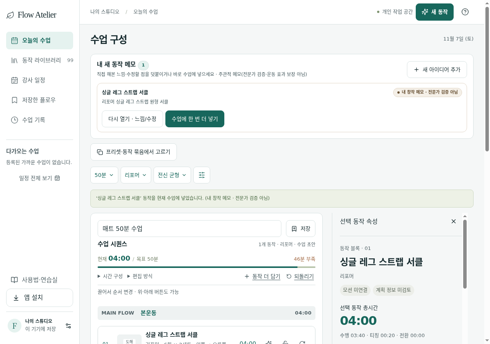

# Track A — 작은 동작 → 중간 블록 → 시퀀스 중첩 반복·편측·휴식·전환시간 경계값 검증 보고서

- **검증 일자**: 2026-11-07
- **검증 스크립트**: [`scripts/class-flow-audit-20261107/track-a/run-track-a.mjs`](../../../scripts/class-flow-audit-20261107/track-a/run-track-a.mjs)
- **합성 Fixture**: [`scripts/class-flow-audit-20261107/shared/synthetic-fixtures.mjs`](../../../scripts/class-flow-audit-20261107/shared/synthetic-fixtures.mjs)
- **결과 데이터**: [`docs/class-flow-audit-20261107/track-a/results.json`](./results.json)
- **대상 소스 (READ-ONLY 검증)**:
  - [`src/utils/movementIdeaDraft.ts`](../../../src/utils/movementIdeaDraft.ts)
  - [`src/utils/humanMovementCreation.ts`](../../../src/utils/humanMovementCreation.ts)
  - [`src/utils/hierarchyModel.ts`](../../../src/utils/hierarchyModel.ts)
  - [`src/utils/sequenceEngine.ts`](../../../src/utils/sequenceEngine.ts)
  - [`src/utils/sequenceSimulation.ts`](../../../src/utils/sequenceSimulation.ts)
  - [`src/utils/stepTimeEstimate.ts`](../../../src/utils/stepTimeEstimate.ts)
  - [`src/schemas/cloudBackupSchema.ts`](../../../src/schemas/cloudBackupSchema.ts)
  - [`src/schemas/stepTimeEstimate.ts`](../../../src/schemas/stepTimeEstimate.ts)
  - [`src/store/usePilatesStore.ts`](../../../src/store/usePilatesStore.ts)
  - [`src/components/MovementIdeaSheet.tsx`](../../../src/components/MovementIdeaSheet.tsx)
  - [`src/components/StepBlockInspector.tsx`](../../../src/components/StepBlockInspector.tsx)
  - [`src/components/StepTimeEstimateEditor.tsx`](../../../src/components/StepTimeEstimateEditor.tsx)

---

## 1. 검증 범위 및 계층 흐름 요약

| 계층 | 주요 타입 / 함수 | 검증 항목 |
| --- | --- | --- |
| **1단계: 작은 동작 (Small Movement)** | `MovementIdeaDraftInput`, `HumanMovementDraft`, `saveMovementIdeaDraft`, `calculateIdeaStepTimeBreakdown` | 1줄 아이디어 생성, `repetitions`(1..1000)·`sets`(1..100)·`sideMode`(`together`/`left`/`right`/`left-then-right`/`right-then-left`)·`explanationSec`·`transitionSec` 경계값, 저장 후 값 비우기(`undefined`) 동작 |
| **2단계: 중간 블록 (Reusable Block)** | `ReusableBlock`, `saveIdeaToReusableBlock`, `createReusableBlock`, `appendIdeaToReusableBlock`, `updateReusableBlockItemOptions`, `adjustReusableBlockItemDuration` | 동작→블록 승격 시 스키마 상한(`repetitions <= 500`, `sets <= 50`), 블록 아이템별 시간·세트·전환시간 오버라이드, 최소 시간(`Math.max(1, (explanationSec + transitionSec + 30)/60)`) 하한 |
| **3단계: 시퀀스 편입 및 휴식·전환시간 (Sequence & Rest/Transition)** | `addMovementIdeaToCurrentClass`, `insertIdeaReusableBlockToCurrentClass`, `insertReusableBlockIntoSequence`, `insertRestStepAt`, `calculateTransitionCost`, `getStepTiming`, `getSequenceDurations` | 빈 시퀀스 첫 동작 `transitionSec` 처리, 블록 복사 시 `sourceBlockId`/`sourceBlockTitle`/`selectedLayer` 전파, 기구·박스·스프링·자세 전환 비용(`+45s`, `+30s`, `+15s`, `+10s`), 별도 휴식(`kind: 'rest'`, 1~15분, 수업 총시간-1분 상한) |
| **4단계: 수업 시뮬레이션 및 저장/재열기 (Simulation & Snapshot)** | `buildSequenceSimulation`, `seekSequenceSimulation`, `calculateStepTimeEstimate`, `saveCurrentSequenceToBinder`, `stepSchema` | 세트 내 양측 분할(`left-then-right`/`right-then-left`), 세트 간 휴식(`restBetweenSetsSec`), 총 시간 합산 정합성, 로컬스토리지 재열기 시 `stepSchema` 검증 |

---

## 2. 실제 통과 (Actual Pass) 항목

1. **A1-01 — 1줄 동작 초안 기본값 및 로컬 지속성 (`saveMovementIdeaDraft`)**
   - 1줄 메모만 입력해도 `defaultDurationMin: 4`, `explanationSec: 20`, `transitionSec: 15`, `isUnilateral: false`로 즉시 동작 생성 및 `localStorage` 영속화 통과.
2. **A1-02 — 양측 순차(`left-then-right`, `right-then-left`) 및 양쪽 동시(`together`) 시간 분해**
   - `durationMin: 4` (240s), `explanationSec: 20`, `transitionSec: 15`일 때 실제 움직임 시간 `205s` 산출 및 양측 순차 시 한쪽당 `102s`(`Math.floor(205/2)`) 미리보기 일치 확인.
3. **A2-02 — 중간 블록 아이템 최소 시간 하한 방어 (`updateReusableBlockItemOptions`, `adjustReusableBlockItemDuration`)**
   - `explanationSec(45) + transitionSec(45) + 30s = 120s (2분)`일 때 `durationMin: 1`로 축소 시도를 거부(`success: false`)하여 음수 움직임 시간 방지 확인.
4. **A3-02 — 기구·박스·스프링·자세 전환 비용 경계값 (`calculateTransitionCost`)**
   - 동일 세팅 `0s`, 자세 변경 `+10s`, 스프링 변경 `+15s`, 박스 변경 `+30s`, 기구 변경 `+45s`, 복합 변경(기구+박스+스프링+자세 = `45+30+15+10 = 100s`) 정확히 일치.
5. **A3-03 — 별도 휴식 스텝(`kind: 'rest'`) 경계값 검증**
   - 1분 미만(`0.5분`) 및 15분 초과(`16분`) 거부, 시퀀스 목표 시간(`activeTargetMinutes - 1분`) 초과 휴식 거부, 정상 휴식(`2분 = 120s`) 삽입 시 `restSec`에만 합산되고 `explanationSec`/`transitionSec`는 `0s`로 분리됨을 확인.
6. **A4-01 — 중첩 시뮬레이션 타임라인(`buildSequenceSimulation`, `seekSequenceSimulation`) 총합 정합성**
   - `[Transition -> Cue -> Set 1 Side 1 -> Set 1 Side 2 -> Set Rest -> Set 2 Side 1 -> Set 2 Side 2]` 및 별도 휴식 스텝(`rest`)의 세그먼트 합계가 `getSequenceDurations(steps).totalSec`와 1초 오차 없이 일치하며, 경계 시각(`0s`, 전환 직후, 세트 간 휴식 중간, 종료 시각) 탐색이 정확히 동작함을 확인.
7. **A5-01 — UI 시간 미리보기 및 인스펙터 연동**
   - `MovementIdeaSheet` 내 `[data-testid="idea-step-timing-preview"]` 및 `StepBlockInspector` 내 `StepTimeEstimateEditor` 동작 확인.

---

## 3. 재현한 결함 (Reproduced Defects)

### DEF-A01 (Medium) — 단측(`sideMode: 'left' | 'right'`) 선택 시 `MovementIdeaSheet` 미리보기와 시퀀스 엔진 간 편측 시간 불일치

- **파일 및 위치**:
  - [`src/utils/movementIdeaDraft.ts:500-501`](../../../src/utils/movementIdeaDraft.ts#L500-L501) (`calculateIdeaStepTimeBreakdown`)
  - [`src/utils/movementIdeaDraft.ts:875`](../../../src/utils/movementIdeaDraft.ts#L875) (`saveMovementIdeaDraft`)
  - [`src/utils/sequenceEngine.ts:399-405`](../../../src/utils/sequenceEngine.ts#L399-L405) (`getStepSideCount`, `getStepTiming`)
  - [`src/utils/stepTimeEstimate.ts:11`](../../../src/utils/stepTimeEstimate.ts#L11) (`calculateStepTimeEstimate`)
- **재현 절차**:
  1. `MovementIdeaSheet`에서 새 동작을 작성하고 상세의 **좌우 진행**을 `왼쪽만 (left)` 또는 `오른쪽만 (right)`으로 선택한다 (`durationMin = 4`, `explanationSec = 20`, `transitionSec = 15`).
  2. `saveMovementIdeaDraft`는 `sideMode !== 'together'`이면 무조건 `isUnilateral: true`로 저장하고, `calculateIdeaStepTimeBreakdown`은 `sideMode`를 확인하지 않은 채 `isUnilateral === true`이면 `perSideSec = Math.floor(movementSec / 2)` (`102초`)로 2분할하여 표시한다.
  3. 반면 수업 시퀀스에 추가된 후 `getStepSideCount`(`sequenceEngine.ts:401`)와 `calculateStepTimeEstimate`(`stepTimeEstimate.ts:11`)는 `left-then-right`/`right-then-left`만 2측으로 계산하고 `left`/`right` 단측은 1측(`perSideMovementSec: null`)으로 계산한다.
- **스크린샷**:
  - 
- **최소 수정 제안**:
  - `calculateIdeaStepTimeBreakdown`에 `sideMode` 인자를 전달하거나 `const hasTwoSides = sideMode ? (sideMode === 'left-then-right' || sideMode === 'right-then-left') : Boolean(input.isUnilateral)`로 판별하고, `saveMovementIdeaDraft`에서도 `isUnilateral`을 양측 순차(`left-then-right` | `right-then-left`)일 때만 `true`로 설정한다.

---

### DEF-A02 (High) — `repetitions`/`sets` 상한 초과 시 미포착 `ZodError` 예외 발생, 동작↔중간블록 상한(`1000/100` vs `500/50`) 불일치, 저장된 횟수/세트 값 비우기 불가

- **파일 및 위치**:
  - [`src/utils/movementIdeaDraft.ts:806-830`](../../../src/utils/movementIdeaDraft.ts#L806-L830) (`saveMovementIdeaDraft`)
  - [`src/utils/humanMovementCreation.ts:30-31`](../../../src/utils/humanMovementCreation.ts#L30-L31), [`96`](../../../src/utils/humanMovementCreation.ts#L96) (`humanMovementDraftInputSchema`, `createHumanMovementIdeaDraft`)
  - [`src/utils/hierarchyModel.ts:185-186`](../../../src/utils/hierarchyModel.ts#L185-L186) (`reusableBlockItemSchema`)
  - [`src/components/MovementIdeaSheet.tsx:612`](../../../src/components/MovementIdeaSheet.tsx#L612)
- **재현 절차**:
  1. `MovementIdeaSheet`의 `<form noValidate>`에서 반복 횟수에 `1500` 또는 세트에 `150`을 입력하고 저장을 누른다. `saveMovementIdeaDraft`는 상한 검증 없이 `syncHumanDraftOnSave` → `createHumanMovementIdeaDraft`의 `.parse()`를 호출하여 **포착되지 않는 `ZodError` 예외**가 발생하고 UI 저장 핸들러가 중단된다.
  2. 반복 횟수에 `600`(501~1000) 또는 세트에 `60`(51~100)을 입력하면 동작 초안(`humanMovementDraftInputSchema`: `max(1000)` / `max(100)`)은 정상 저장되지만, 이어서 중간 블록으로 묶기(`saveIdeaToReusableBlock`)를 실행하면 `reusableBlockItemSchema`(`max(500)` / `max(50)`)에서 검증 실패(`success: false`)하여 승격이 거부된다.
  3. 한 번 `repetitions: 12`, `sets: 3`을 저장한 동작을 다시 열어 입력칸을 비우면(`undefined`), `saveMovementIdeaDraft`(`807-822행`)의 `repetitions ?? existingMeta?.repetitions` 폴백 때문에 이전 값(`12`, `3`)이 지워지지 않고 그대로 남는다.
- **최소 수정 제안**:
  - `saveMovementIdeaDraft`에서 `repetitions`(1..500), `sets`(1..50) 상한을 `reusableBlockItemSchema` 및 `stepSchema`와 동일하게 맞추고, `syncHumanDraftOnSave` 내부에서 `safeParse`로 감싸 `{ success: false, error }`를 반환하도록 수정한다.
  - 수정 모드에서 사용자가 입력칸을 비운 경우 `undefined`로 초기화할 수 있도록 명시적 해제(`null` 또는 입력폼 전체 스냅샷 반영)를 지원한다.

---

### DEF-A03 (High) — 중간 블록(`ReusableBlock`)을 시퀀스에 복사한 뒤 저장·새로고침하면 `selectedLayer: undefined`로 인해 `stepSchema` 검증이 실패하고 `savedSequences` 전체가 유실됨

- **파일 및 위치**:
  - [`src/utils/hierarchyModel.ts:845`](../../../src/utils/hierarchyModel.ts#L845) (`createReusableBlock`)
  - [`src/utils/hierarchyModel.ts:1489`](../../../src/utils/hierarchyModel.ts#L1489) (`insertReusableBlockIntoSequence`)
  - [`src/schemas/cloudBackupSchema.ts:299`](../../../src/schemas/cloudBackupSchema.ts#L299) (`stepSchema`)
  - [`src/store/usePilatesStore.ts:2481`](../../../src/store/usePilatesStore.ts#L2481) (`mergePersistedState`)
- **재현 절차**:
  1. 새 동작 초안으로 중간 블록(`saveIdeaToReusableBlock` / `createReusableBlock`)을 생성한다 (`selectedLayer` 미지정 시 `undefined`).
  2. `insertIdeaReusableBlockToCurrentClass`("수업 시퀀스에 블록 복사해 넣기")를 실행하면 생성된 `SequenceStep`의 `selectedLayer`가 `'standard'` 기본값 없이 `undefined`로 들어간다 (`insertReusableBlockIntoSequence` 1489행).
  3. "저장" 버튼(`saveCurrentSequenceToBinder`)을 눌러 바인더에 저장한 뒤 브라우저를 새로고침하면, `usePilatesStore.ts:2481`에서 `z.array(sequenceSchema).safeParse(raw.savedSequences)`가 `stepSchema.selectedLayer`(`layerSchema` 필수) 검증에 실패하여 **방금 저장한 수업뿐 아니라 `savedSequences` 배열 전체가 초기 샘플로 리셋**된다.
- **최소 수정 제안**:
  - `createReusableBlock`(`hierarchyModel.ts:845`) 및 `insertReusableBlockIntoSequence`(`hierarchyModel.ts:1489`)에서 `selectedLayer: item.selectedLayer ?? 'standard'`로 기본값을 보장한다.

---

### DEF-A04 (Medium) — 빈 시퀀스에 첫 새 동작을 바로 넣을 때(`addMovementIdeaToCurrentClass`) 첫 동작에 불필요한 전환시간 `transitionSec: 15`가 부여됨

- **파일 및 위치**:
  - [`src/utils/movementIdeaDraft.ts:1666-1680`](../../../src/utils/movementIdeaDraft.ts#L1666-L1680) (`addMovementIdeaToCurrentClass`)
  - [`src/store/usePilatesStore.ts:1772`](../../../src/store/usePilatesStore.ts#L1772) (`appendExerciseToSequence`)
- **재현 절차**:
  1. 시퀀스가 비어 있는 상태(`activeSteps.length === 0`)에서 `MovementIdeaSheet`의 "수업에 넣기"를 실행한다.
  2. `appendExerciseToSequence`는 첫 스텝이므로 `transitionSec: 0`으로 추가하지만, 직후 `addMovementIdeaToCurrentClass` 1673행이 `transitionSec: timing.transitionSec`(기본값 `15`초)로 덮어써 버린다. (반면 1702행의 fallback 경로는 `afterAppend.activeSteps.length === 0 ? 0 : timing.transitionSec`로 분기하고 있어 주 경로와 불일치함.)
- **최소 수정 제안**:
  - `addMovementIdeaToCurrentClass` 1666-1675행에서 첫 스텝(`targetIndex === 0`이고 기존에 사용자가 명시적으로 전환시간을 강제한 경우가 아닐 때)에는 `transitionSec: 0`을 유지하거나 `targetIndex === 0 ? 0 : timing.transitionSec`를 적용한다.

---

### DEF-A05 (Medium) — `insertIdeaReusableBlockToCurrentClass`가 `undoStack` 기록 및 빈 시퀀스의 `activeApparatus` 동기화를 우회함

- **파일 및 위치**:
  - [`src/utils/movementIdeaDraft.ts:1508-1513`](../../../src/utils/movementIdeaDraft.ts#L1508-L1513) (`insertIdeaReusableBlockToCurrentClass`)
- **재현 절차**:
  1. 빈 시퀀스에서 중간 블록의 "수업에 복사"(`insertIdeaReusableBlockToCurrentClass`)를 실행한다.
  2. `usePilatesStore.setState({ activeSteps: inserted.steps, ... })`를 직접 호출하기 때문에 `undoStack`에 이전 상태가 저장되지 않아 **되돌리기(Undo)가 불가능**하며, 캐딜락·체어 등 다른 기구 블록을 빈 시퀀스에 복사해도 `activeApparatus`가 갱신되지 않는다.
- **최소 수정 제안**:
  - `usePilatesStore` 내부 액션(예: `insertStepsIntoWorkbench`)을 통해 `edit(state, { activeSteps })` 헬퍼를 거치도록 일원화한다.

---

### DEF-A06 (Low) — `calculateStepTimeEstimate`가 `durationMin = totalSec / 60`을 반올림 없이 반환하여 인스펙터 입력창에 무한소수가 노출됨

- **파일 및 위치**:
  - [`src/utils/stepTimeEstimate.ts:31`](../../../src/utils/stepTimeEstimate.ts#L31) (`calculateStepTimeEstimate`)
  - [`src/components/StepBlockInspector.tsx:161`](../../../src/components/StepBlockInspector.tsx#L161)
- **재현 절차**:
  1. 스텝 상세 편집(`StepBlockInspector`)에서 자동 시간 추정(`autoComputeDuration`)을 켜고 총 시간이 60의 배수가 아닌 조합(예: 총 `149초` = 설명 20초 + 전환 15초 + 양측 세트 99초 + 세트휴식 15초)을 만든다.
  2. `durationMin` 입력창에 `2.4833333333333334`가 그대로 노출된다.
- **스크린샷**:
  - 
- **최소 수정 제안**:
  - `calculateStepTimeEstimate`에서 `const durationMin = Number((totalSec / 60).toFixed(2))`로 소수점 둘째 자리까지 정규화한다.

---

### DEF-A07 (Low) — 홀수 움직임 시간(`movementSec`)의 양측 분할 시 `Math.floor` 화면 표시와 `movementSec / 2` 시뮬레이션 간 0.5초 반올림 차이

- **파일 및 위치**:
  - [`src/utils/movementIdeaDraft.ts:501`](../../../src/utils/movementIdeaDraft.ts#L501) (`Math.floor(movementSec / 2)`)
  - [`src/components/StepBlockInspector.tsx:266`](../../../src/components/StepBlockInspector.tsx#L266) (`Math.floor(timingPreview.movementSec / 2)`)
  - [`src/utils/sequenceEngine.ts:404`](../../../src/utils/sequenceEngine.ts#L404) (`movementSec / 2`)
  - [`src/utils/sequenceSimulation.ts:220`](../../../src/utils/sequenceSimulation.ts#L220) (`sideTotalSec / sideCount`)
- **재현 절차**:
  1. `durationMin = 1.5` (90초), `explanationSec = 20`, `transitionSec = 19`, `sideMode = 'left-then-right'`로 설정하면 `movementSec = 51초`가 된다.
  2. `MovementIdeaSheet`와 `StepBlockInspector`는 `Math.floor(51 / 2) = 25초`로 표시하지만, `getStepTiming`은 `25.5초`, `buildSequenceSimulation`은 세그먼트 길이를 `25.5초`로 생성하고 라벨 표기 시 `Math.round(25.5) = 26초`로 출력한다.
- **최소 수정 제안**:
  - 양측 분할 시 1측 시간을 `Math.floor(movementSec / 2)`로 통일하고 나머지 1초는 두 번째 측 또는 전환 여유에 배분하거나 동일한 반올림 규칙을 사용한다.

---

## 4. 미검증 (Unverified) 경계

- **클라우드 원격 백업 서버 왕복 동기화**: 인증·외부 유료/원격 호출 금지 원칙에 따라 로컬 스토리지 및 `cloudBackupSchema` 파서까지만 검증하였으며 실제 원격 서버 업로드/다운로드는 미검증으로 분류함.
