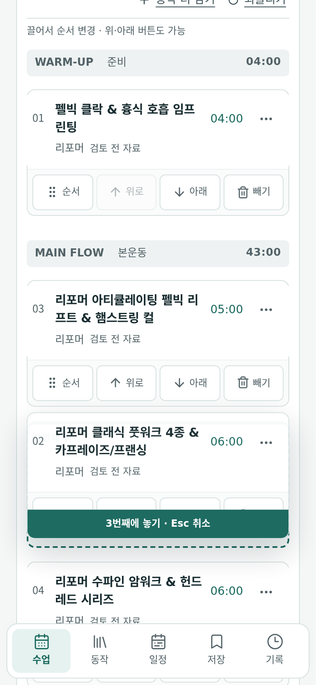
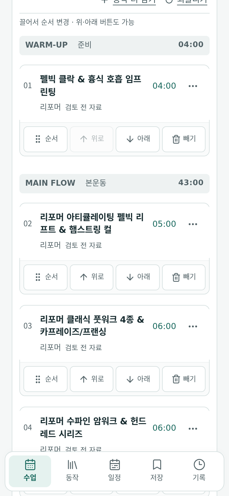
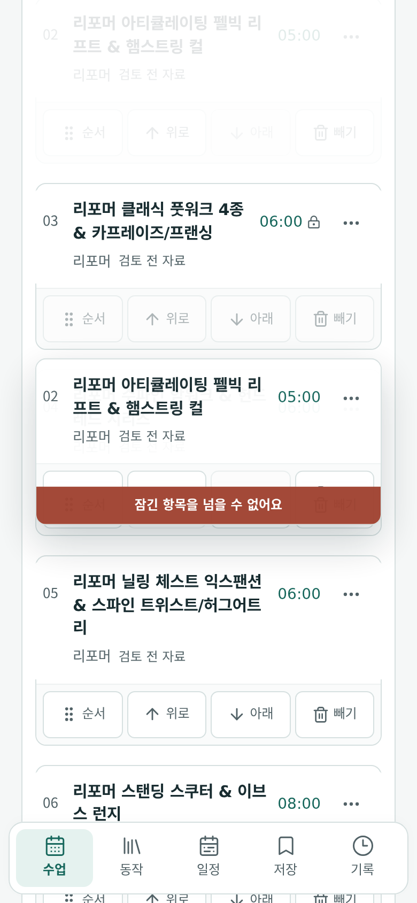
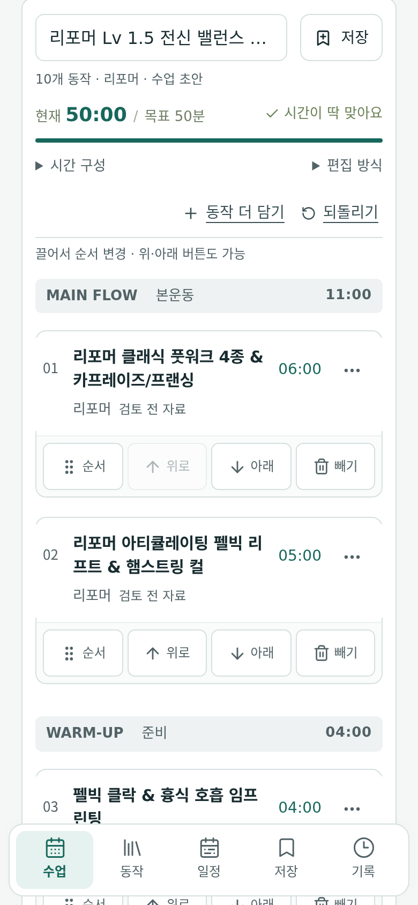

# Track B — 모바일 드래그·키보드 순서변경·취소·자동스크롤·시각 피드백 실제 브라우저 검증 보고서

- **검증 일자**: 2026-11-07
- **검증 스크립트**: [`scripts/class-flow-audit-20261107/track-b/run-track-b.mjs`](../../../scripts/class-flow-audit-20261107/track-b/run-track-b.mjs)
- **결과 데이터**: [`docs/class-flow-audit-20261107/track-b/results.json`](./results.json)
- **검증 환경**: 실제 Chromium Headless 브라우저 (`390×844` 모바일 터치/포인터 에뮬레이션)
- **대상 소스 (READ-ONLY 검증)**:
  - [`src/utils/sequenceDrag.ts`](../../../src/utils/sequenceDrag.ts)
  - [`src/components/SequenceOrderCard.tsx`](../../../src/components/SequenceOrderCard.tsx)
  - [`src/components/SequenceWorkbench.tsx`](../../../src/components/SequenceWorkbench.tsx)
  - [`src/store/usePilatesStore.ts`](../../../src/store/usePilatesStore.ts)
  - [`src/styles/sequence-drag.css`](../../../src/styles/sequence-drag.css)
  - [`src/styles/sequence-composition.css`](../../../src/styles/sequence-composition.css)

---

## 1. 검증 범위 요약

| 검증 영역 | 대상 구현 | 검증 시나리오 |
| --- | --- | --- |
| **B1. 키보드 순서변경 및 포커스·스크롤 여백** | `SequenceOrderCard.tsx:36-51, 101-113` | `ArrowUp`/`ArrowDown` 키 입력 시 순서 교환(`reorderStep`), 이동 후 동일 스텝 핸들(`#order-handle-${stepId}`)로 포커스 복원(`requestAnimationFrame`), 최상단(index 0) 경계 방어(`upDisabled`), 스크롤 여백 적용 |
| **B2. 모바일 터치/포인터 드래그 임계값(8px)·시각 피드백·커밋** | `sequenceDrag.ts:129-232, 260-311`, `SequenceOrderCard.tsx:62-96` | `4px` 이동 시 드래그 미시작(`Math.hypot < 8`), `8px` 이상 이동 시 `.flow-sections[data-drag-session="true"]`, 원본 카드 `[data-drag-source="true"]`, 대상 카드 `[data-drag-over="true"]`, `.sequence-drag-overlay`(고스트 카드), `.sequence-drop-indicator`(드롭 위치 표시) 및 `pointerup` 커밋 |
| **B3. 드래그 취소 (`Escape`·`pointercancel`·화면 밖 드롭·`blur`)** | `sequenceDrag.ts:117-128, 177-179, 271-309`, `SequenceOrderCard.tsx:97-105` | 드래그 중 `Escape` 키, `pointercancel`, `.flow-sections` 범위 밖(`clientX = 2, clientY = 10`) 드롭, 또는 `window` `blur` 발생 시 프리뷰 즉시 해제 및 원래 순서 100% 보존 |
| **B4. 잠금 카드(`locked`) 통과 차단 및 시각 피드백** | `sequenceDrag.ts:31-34, 192-201`, `usePilatesStore.ts:1660-1689` | 중간 카드를 잠금(`toggleStepLock`)한 뒤 앞선 카드를 잠금 카드 너머로 드래그할 때 `.sequence-drag-overlay[data-drag-blocked="true"]`, `.sequence-drop-indicator` 숨김(`hidden`), 상태 배지 `"잠긴 항목을 넘을 수 없어요"` 표시 및 드롭 시 순서 변경 차단 |
| **B5. 뷰포트 상·하단 가장자리 정지 홀드 자동스크롤** | `sequenceDrag.ts:233-259` | 카드를 잡은 채 모바일 하단 네비게이션(`.bottom-nav`) 위쪽 가장자리(`navTop - 64px` 이내)에 정지 홀드할 때 `requestAnimationFrame(tick)` 루프가 연속 자동 스크롤(`window.scrollY` 증가) 수행 |
| **B6. 구간(`준비`·`본운동`·`마무리`) 간 이동 시 헤더 구조 및 프리뷰 정렬** | `usePilatesStore.ts:1660-1695`, `SequenceWorkbench.tsx:436-445`, `sequenceDrag.ts:205-215` | `준비(warmup)` 카드를 `본운동(main)` 카드들 사이로 드래그·드롭할 때 프리뷰 이동량(`shift`)과 드롭 후 섹션 그룹핑(`sectionRuns`) 검증 |

---

## 2. 실제 통과 (Actual Pass) 항목

1. **B1-01 — 키보드 `ArrowUp`/`ArrowDown` 순서변경, 포커스 유지 및 최상단 경계 방어**
   - 2번째 스텝 핸들(`#order-handle-s-2`)에서 `ArrowUp` 입력 시 1번째(index 0)로 이동하고 `document.activeElement.id`가 `order-handle-s-2`를 유지함.
   - 1번째 위치에서 추가 `ArrowUp` 입력 시 `upDisabled`로 방어되어 순서가 변하지 않으며, `ArrowDown` 입력 시 원래 자리로 복귀함.
2. **B2-01 — 8px 드래그 시작 임계값, 고스트 오버레이·드롭 인디케이터 시각 피드백, 드롭 커밋**
   - `pointerdown` 후 `+4px` 이동 시 `.flow-sections[data-drag-session]`이 활성화되지 않아 단순 탭/미세 흔들림 오작동을 방지함(`Math.hypot < 8`).
   - 임계값(`8px`) 초과 이동 후 타깃 카드 진입 시:
     - `.flow-sections[data-drag-session="true"]`
     - 원본 카드 `[data-drag-source="true"]`, 대상 카드 `[data-drag-over="true"]`
     - 플로팅 고스트(`.sequence-drag-overlay[data-drag-blocked="false"]`) 및 드롭 인디케이터(`.sequence-drop-indicator`, 텍스트 `"3번째 위치"`) 렌더링 확인
   - `pointerup` 시 변경된 순서가 스토어에 확정되고 드래그 세션이 즉시 정리됨.
   - 스크린샷: 
3. **B3-01 — `Escape`, `pointercancel`, 범위 밖 드롭(`x=2, y=10`), `window blur` 취소 복원**
   - 4가지 취소 경로 모두에서 드래그 프리뷰가 즉시 해제되고 원래 순서가 100% 보존됨을 확인.
   - 범위 밖 이동 시 `.sequence-drag-overlay[data-drag-blocked="true"]` 및 `"목록 안에 놓아 주세요"` 안내 표시 확인.
   - 스크린샷: 
4. **B4-01 — 잠금(`locked`) 카드 장벽 및 `data-drag-blocked="true"` 피드백**
   - 3번째 카드(index 2)를 잠근 뒤 2번째 카드(index 1)를 4번째 카드(index 3) 위치로 드래그하면 `resolveSequenceDrop`이 `blocked: true`를 반환하여 `.sequence-drag-overlay[data-drag-blocked="true"]`, `.sequence-drop-indicator.hidden === true`, `.sequence-drag-status`에 `"잠긴 항목을 넘을 수 없어요"`를 표시하며 드롭 시 원래 순서를 유지함.
   - 스크린샷: 
5. **B5-01 — 뷰포트 하단 가장자리(`.bottom-nav` 상단) 정지 홀드 시 연속 자동스크롤 (`requestAnimationFrame`)**
   - 모바일(`390×844`)에서 카드를 잡고 `.bottom-nav` 바로 위 가장자리(`edgeY`)에서 추가 `pointermove` 없이 420ms 홀드 시 `window.scrollY`가 연속 증가함을 실제 브라우저에서 확인.

---

## 3. 재현한 결함 (Reproduced Defects)

### DEF-B01 (Medium) — 구간(`준비`·`본운동`·`마무리`) 경계를 넘어 순서 변경 시 `classSection`/`blockCategory`가 갱신되지 않아 동일 구간 헤더(`"본운동"`)가 여러 개로 쪼개짐

- **파일 및 위치**:
  - [`src/store/usePilatesStore.ts:1660-1695`](../../../src/store/usePilatesStore.ts#L1660-L1695) (`reorderStep`, `moveStep`)
  - [`src/components/SequenceWorkbench.tsx:436-445`](../../../src/components/SequenceWorkbench.tsx#L436-L445) (`sectionRuns`)
- **재현 절차**:
  1. 기본 8동작 시퀀스(`준비 1개 + 본운동 6개 + 마무리 1개`)에서 1번 `준비(warmup)` 동작 카드를 드래그하여 `본운동(main)` 동작들 사이(index 2)에 놓는다.
  2. `reorderStep`은 배열 순서와 `order` 번호만 바꿀 뿐 이동한 스텝의 `classSection`/`blockCategory`를 대상 구간에 맞게 갱신하지 않는다.
  3. 그 결과 `SequenceWorkbench.tsx:440-445`의 `sectionRuns`(인접 스텝의 `sectionOf(step)` 연속 구간 묶기)가 **`본운동 → 준비 → 본운동 → 마무리` (총 4개 섹션 블록)** 으로 쪼개져 화면에 `본운동` 섹션 헤더가 중복 생성된다.
- **스크린샷**:
  - 
- **최소 수정 제안**:
  - 사용자가 카드를 다른 구간(`warmup` / `main` / `cooldown`)으로 이동할 때 대상 위치의 구간에 맞춰 `step.classSection`을 업데이트하거나, 섹션 그룹핑을 고정 3구간으로 유지한다.

---

### DEF-B02 (Low) — 구간 헤더(`.pf-sequence-block`)를 넘어 드래그할 때 `sequenceDrag.ts`의 `gap` 계산이 섹션 헤더 높이를 카드 간격으로 오인해 대상 카드들이 섹션 헤더 위로 과도하게 밀려 올라감

- **파일 및 위치**:
  - [`src/utils/sequenceDrag.ts:205-215`](../../../src/utils/sequenceDrag.ts#L205-L215) (`draw`)
- **재현 절차**:
  1. 1번 `준비` 카드(`from = 0`)와 2번 `본운동` 첫 카드(`from + 1 = 1`) 사이에는 `.pf-sequence-block`의 여백과 `본운동` 섹션 헤더가 존재하여 두 카드 간 수직 거리(`positions[1].top - source.top - source.height`)가 일반 섹션 내 카드 간격(`~12px`)보다 훨씬 크다.
  2. `sequenceDrag.ts:207`은 `gap = Math.max(0, positions[from + 1].top - source.top - source.height)`를 계산한 뒤 `shift = source.height + gap`만큼 `i = 1..to`의 모든 카드를 `translateY(-shift)`로 위로 이동시킨다.
  3. 이로 인해 1번 `준비` 카드를 `본운동`으로 드래그하는 동안 `본운동` 카드들이 섹션 헤더 높이만큼 과도하게 위로 솟구쳐 `본운동` 섹션 헤더와 겹친다.
- **최소 수정 제안**:
  - `sequenceDrag.ts:205-215`에서 `positions[from ± 1]`이 다른 `.pf-sequence-block`에 속해 있을 경우 동일 섹션 내 인접 카드 간격(또는 기본값 `12px`)을 `gap`으로 사용하도록 보정한다.

---

## 4. 미검증 (Unverified) 경계

- **실제 물리 iOS Safari / Android Chrome 네이티브 햅틱 피드백**: Chromium CDP 터치/포인터 에뮬레이션으로 검증하였으며 물리 기기 OS 레벨 진동/관성 스크롤 가속도는 미검증으로 분류함.
