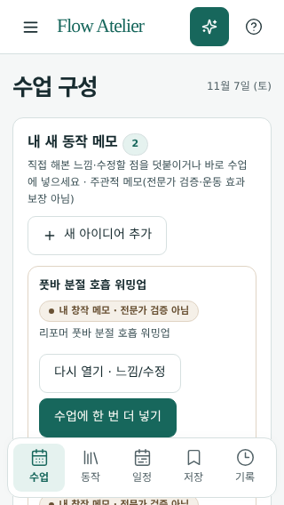
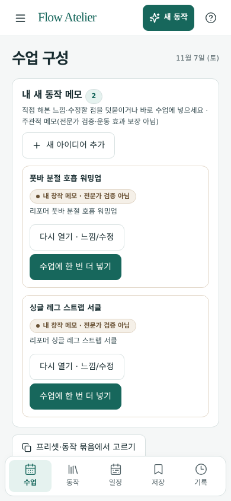
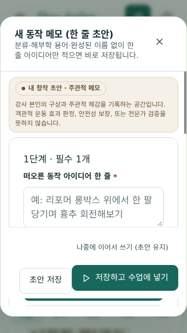
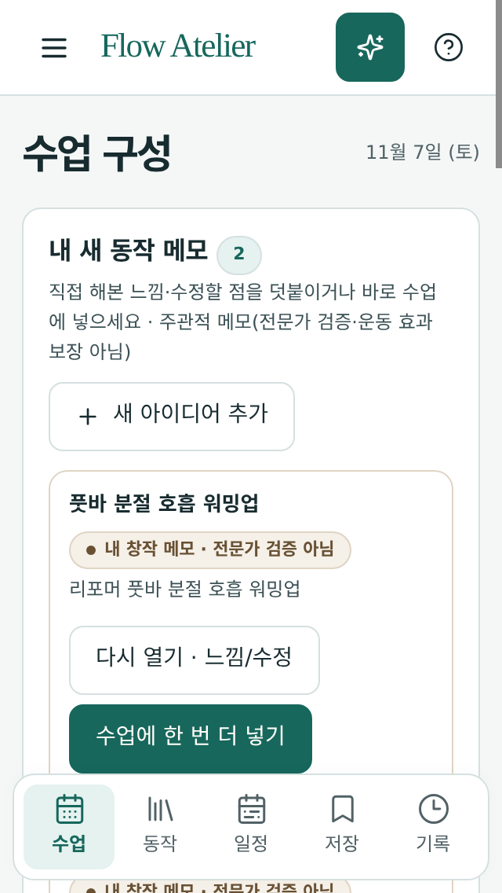
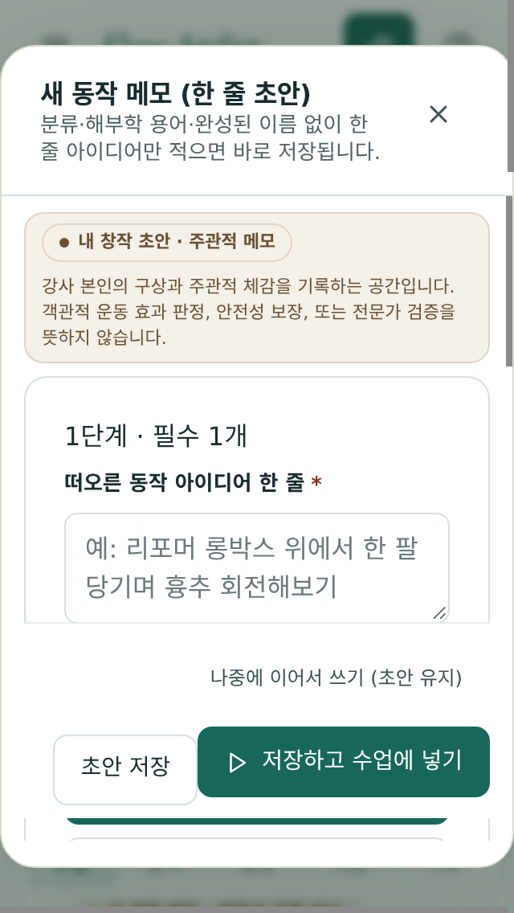

# Track C — 320·390·768·1440 & 200% 새 동작 추가 → 조합 → 저장 → 재열기 최소 동선 및 화면 밀도 검증 보고서

- **검증 일자**: 2026-11-07
- **검증 스크립트**: [`scripts/class-flow-audit-20261107/track-c/run-track-c.mjs`](../../../scripts/class-flow-audit-20261107/track-c/run-track-c.mjs)
- **결과 데이터**: [`docs/class-flow-audit-20261107/track-c/results.json`](./results.json)
- **대상 소스 (READ-ONLY 검증)**:
  - [`src/App.tsx`](../../../src/App.tsx)
  - [`src/App.css`](../../../src/App.css)
  - [`src/components/SequenceWorkbench.tsx`](../../../src/components/SequenceWorkbench.tsx)
  - [`src/components/MovementIdeaSheet.tsx`](../../../src/components/MovementIdeaSheet.tsx)
  - [`src/components/ClassBinderView.tsx`](../../../src/components/ClassBinderView.tsx)
  - [`src/utils/movementIdeaDraft.ts`](../../../src/utils/movementIdeaDraft.ts)
  - [`src/utils/hierarchyModel.ts`](../../../src/utils/hierarchyModel.ts)
  - [`src/store/usePilatesStore.ts`](../../../src/store/usePilatesStore.ts)

---

## 1. 최소 동선 (Minimum Interaction Path) 검증 결과

초보 강사가 빈 화면에서 **새 동작 추가 → 중간 블록(ReusableBlock) 조합 → 시퀀스 편입 → 수업 저장 → 바인더 재열기 → 브라우저 새로고침 유지**까지 수행하는 동선을 실제 Chromium 브라우저에서 검증했습니다.

| 경로 구분 | 단계별 조작 (클릭/입력) | 총 핵심 조작 수 | 검증 결과 |
| --- | --- | --- | --- |
| **빠른 경로 (단일 동작 → 시퀀스 → 저장)** | 1) `.workbench-idea-action` (`한 줄 아이디어 메모`) 클릭 2) `textarea[aria-label="한 줄 아이디어"]` 입력 3) `[data-testid="idea-save-and-add"]` (`수업에 넣기`) 클릭 4) `button.save-flow` (`저장`) 클릭 | **4회** | **실제 통과 (Actual Pass)** |
| **조합 경로 (동작 2개 → 재사용 블록 조합 → 시퀀스 복사 → 저장 → 바인더 재열기)** | 1) 동작 #1 입력 및 `[data-testid="create-reusable-block-btn"]` (`초보 리포머 코어 블록`) 생성 + 수업 넣기 2) 동작 #2 입력 및 `button[aria-label*="블록에 현재 동작 추가"]` 클릭 3) `button[aria-label*="수업 시퀀스에 블록 복사해 넣기"]` 클릭 (`activeCardCount = 3`) 4) 시퀀스 제목(`초보 강사 검증용 리포머 50분 수업`) 입력 및 `button.save-flow` (`저장`) 클릭 5) 하단/측면 메뉴 `저장` (`ClassBinderView`) 이동 후 `.teaching-sequence-card`에서 `불러오기` 클릭 (`reopenedCardCount = 3`) | **6단계** | **동일 세션 내 통과 (`C1-01`) / 새로고침 시 `DEF-A03`으로 시퀀스 초기화 재현 (`C1-02`)** |

---

## 2. 뷰포트·배율 매트릭스 (`320` / `390` / `768` / `1440` × `100%` / `200%`) 실측표

동일한 8동작 수업 시퀀스에 새 동작 메모 2개(`.pf-workbench-idea-card`)가 추가된 상태에서 측정한 화면 밀도 및 오버플로우 지표입니다.

| 뷰포트 / 배율 | `scrollWidth` / `clientWidth` | 가로 오버플로우 (`overflowPx`) | `.pf-workbench-ideas` 높이 | 첫 시퀀스 동작 카드 상단 (`firstCardTopPx`) | 첫 동작 카드까지 스크롤 화면 수 (`screensToFirstStepCard`) | 모달(`MovementIdeaSheet`) 폭 × 높이 | 주요 버튼 터치 타깃 (`저장` / `순서`) |
| --- | --- | --- | --- | --- | --- | --- | --- |
| **320×568 @ 100%** | `320` / `320` | `0px` (Pass) | `607px` | `1174px` | **2.07 화면** | `290×1494px` (`0px` overflow) | `77×44px` / `60×44px` |
| **390×844 @ 100%** | `390` / `390` | `0px` (Pass) | `588px` | `1155px` *(메모 없을 때 `554px`, **+601px 밀림**)* | **1.37 화면** | `360×1437px` (`0px` overflow) | `77×44px` / `75×44px` |
| **768×1024 @ 100%** | `768` / `768` | `0px` (Pass) | `324px` | `887px` | **0.87 화면** | `718×1023px` (`0px` overflow) | `77×44px` / `164×44px` |
| **1440×900 @ 100%** | `1425` / `1425` | `0px` (Pass) | `222px` | `796px` | **0.88 화면** | `575×1069px` (`0px` overflow) | `77×44px` / `272×44px` |
| **320×568 @ 200%** | `640` / `320` | **`320px` (Fail)** | `1215px` | `2347px` | **4.13 화면** | `580×2985px` (문서 `320px` overflow) | `154×88px` / `120×88px` |
| **390×844 @ 200%** | `640` / `390` | **`250px` (Fail)** | `1215px` | `2447px` | **2.90 화면** | `580×2985px` (문서 `250px` overflow) | `154×88px` / `114×103px` |
| **768×1024 @ 200%** | `753` / `753` | `0px` (Pass) | `1176px` | `2389px` | **2.33 화면** | `638×3019px` (`0px` overflow) | `154×88px` / `131×88px` |
| **1440×900 @ 200%** | `1425` / `1425` | `0px` (Pass) | `869px` | `2015px` | **2.24 화면** | `1165×2138px` (`0px` overflow) | `154×88px` / `187×88px` |

---

## 3. 실제 통과 (Actual Pass) 항목

1. **C1-01 — 새 동작 추가 → 중간 블록 조합 → 수업 저장 → 바인더 재열기 최소 동선**
   - 초보 강사가 1줄 메모만 입력해도 즉시 동작 생성·블록 묶기·시퀀스 편입·바인더 저장 및 재열기가 완료됨.
2. **C2-01 — 100% 배율 전 구간(`320px`, `390px`, `768px`, `1440px`) 가로 오버플로우 0px 및 44px 터치 타깃 준수**
   - `320px`, `390px`, `768px`, `1440px` 기본 배율에서 `SequenceWorkbench` 및 `MovementIdeaSheet` 모달 모두 가로 스크롤(`overflowPx = 0`)이 전혀 발생하지 않으며, 주요 조작 버튼(`저장`, `순서`, `수업에 넣기`) 높이가 모두 `44px` 이상을 충족함.

---

## 4. 재현한 결함 (Reproduced Defects)

### DEF-C01 (Medium) — 모바일(`320px`·`390px`)에서 시퀀스 내 새 동작 진입 동선 단절 및 `.pf-workbench-ideas` 상단 고정 노출로 인한 화면 밀도 저하

- **파일 및 위치**:
  - [`src/components/SequenceWorkbench.tsx:583-701`](../../../src/components/SequenceWorkbench.tsx#L583-L701) (`.workbench-welcome`, `.pf-workbench-ideas`)
  - [`src/components/SequenceWorkbench.tsx:945-960`](../../../src/components/SequenceWorkbench.tsx#L945-L960) (`.sequence-tools`)
  - [`src/components/SequenceWorkbench.tsx:1274-1291`](../../../src/components/SequenceWorkbench.tsx#L1274-L1291) (`.pf-flow-continuation`)
- **재현 절차**:
  1. **진입 버튼 하단 매몰**: 시퀀스에 동작이 1개 이상 있고(`activeSteps.length > 0`) 아직 작성한 새 동작 메모가 0개일 때(`ideaExercises.length === 0`), 상단 환영 카드(`.workbench-welcome`)가 숨겨지면서 워크벤치 본문 내 `"한 줄 동작 메모"` 버튼이 시퀀스 전체 목록 맨 아래(`.pf-flow-continuation`, `390×844` 기준 **`y = 3050px`, 3.61 화면 아래**)에만 위치한다. (상단 헤더 `.app-create-movement`가 있으나 시퀀스 툴바 `.sequence-tools`의 `"동작 더 담기"` 옆에는 없다.)
  2. **접기 없는 상단 아이디어 섹션의 시퀀스 밀어내기**: 새 동작 메모를 2개 작성하면 `.pf-workbench-ideas` 섹션이 접기(collapse) 토글 없이 시퀀스 최상단(`SequenceWorkbench.tsx:628`)에 항상 펼쳐져 렌더링된다. 이로 인해 첫 번째 수업 시퀀스 동작 카드(`[data-order-step]`) 시작 위치가:
     - `390×844`에서 `554px → 1155px` (**`+601px` 아래로 밀림**, `1.37` 화면)
     - `320×568`에서 **`1174px` (`2.07` 화면 아래)** 로 밀려나 모바일 첫 화면에서 수업 시퀀스 카드를 전혀 볼 수 없다.
- **스크린샷**:
  - 
  - 
  - 
- **최소 수정 제안**:
  - 1) 시퀀스 상단 `.sequence-tools`(`SequenceWorkbench.tsx:945`, `"동작 더 담기"` 옆)에 `"한 줄 동작 메모"` 버튼을 배치하여 스크롤 없이 즉시 새 동작을 추가할 수 있게 한다.
  - 2) `activeSteps.length > 0`일 때 `.pf-workbench-ideas`를 기본 접힘(`
` 또는 요약 바 `내 새 동작 메모 2개 · 펼치기`)으로 전환하여 모바일 첫 화면에 시퀀스 첫 동작 카드가 바로 노출되도록 개선한다.

---

### DEF-C02 (Low) — `320px`·`390px` 모바일 뷰포트에서 `200%` 확대 시 가로 오버플로우(`scrollWidth = 640px`) 발생

- **파일 및 위치**:
  - [`src/App.css`](../../../src/App.css)
  - [`src/components/MovementIdeaSheet.tsx:860-1065`](../../../src/components/MovementIdeaSheet.tsx#L860-L1065)
- **재현 절차**:
  1. `320×568` 및 `390×844` 뷰포트에서 `200%` 확대를 적용하면 문서 `scrollWidth`가 `640px`로 고정되어 `320px`에서 `320px` 오버플로우, `390px`에서 `250px` 가로 오버플로우가 발생한다 (`768px @ 200%` 및 `1440px @ 200%`는 `overflowPx = 0`으로 정상 리플로우됨).
- **스크린샷**:
  - 
  - 
- **최소 수정 제안**:
  - 초소형 실효 폭(`@media (max-width: 360px)`)에서 상단 툴바 및 폼 그리드에 `min-width: 0; flex-wrap: wrap; grid-template-columns: minmax(0, 1fr)`를 적용한다.

---

### DEF-A03 교차 재현 (`C1-02`) — 중간 블록(`ReusableBlock`)을 복사해 넣은 수업을 저장 후 브라우저 새로고침 시 `selectedLayer: undefined`로 인해 시퀀스가 초기화됨

- **재현 결과**:
  - `C1-01`에서 동작 2개를 `초보 리포머 코어 블록`으로 묶고 `"수업 시퀀스에 블록 복사해 넣기"`를 실행한 뒤 바인더에 저장·재열기하면 동일 세션 내에서는 3개 스텝이 정상 복원된다(`reopenedCardCount = 3`).
  - 그러나 직후 `location.reload()`를 실행하면 `insertReusableBlockIntoSequence`(`src/utils/hierarchyModel.ts:1489`)가 누락한 `selectedLayer: 'standard'` 기본값 때문에 `settingsSchema` 및 `sequenceSchema` 파싱이 실패하여 `cardCountAfterReload`가 `3 → 0`으로 초기화되고, 개별 새 동작 메모 카드 2개(`persistedIdeaCardsCount = 2`)만 남는다. (상세 원인은 [Track A 보고서 `DEF-A03`](../track-a/REPORT.md) 참조.)

---

## 5. 미검증 (Unverified) 경계

- **OS 접근성 시스템 폰트 크기(Dynamic Type) 조절**: 브라우저 `100%` 및 `200%` 줌/스케일 매트릭스로 검증하였으며 iOS/Android OS 설정의 전용 Dynamic Type 스케일링은 미검증으로 분류함.
