# Pilates 수업 기록/히스토리 페이지 날짜별 탐색·재사용 동선 개선 전후 증거 (2026-11-07)

## 1. 작업 범위 및 소유권 경계 (Strict Ownership Boundaries)

- **독립 작업 브랜치**: `feat/parallel-page-history-20261107` (최신 `origin/main` 기반)
- **소유 및 수정 파일 (Local History Page Files Only)**:
  - `src/components/ClassBinderView.tsx` — 수업 기록 목록(`view="history"`) 및 이력 상세 모달 로컬 컴포넌트
  - `src/styles/teaching.css` — 수업 기록/상세 스타일 및 모바일·태블릿·PC·200% 확대 반응형 규칙
  - `src/components/ClassBinderView.historyFlow.test.tsx` — 날짜별 탐색·필터 빈 상태·공백/구분자 무관 검색·재사용 위계 로컬 단위/통합 테스트
  - `docs/parallel-page-history-20261107/**` — 전후 브라우저 측정 JSON, 스크린샷 증거, 재현 스크립트 및 독립 검증 보고서
- **비수정 보호 대상 (0 lines changed)**:
  - 실제 데이터 스키마 (`src/schemas/**`, `src/types/**`)
  - 백업/복구 (`src/utils/backupRecoveryInspection.ts`, `src/utils/teachingHistorySnapshot.ts`, `src/components/RecoveryPreview.tsx`)
  - 큐시트 (`src/features/classCueSheet/**`)
  - 공유 스토어 (`src/store/usePilatesStore.ts`)
  - 공유 라우트/앱 셸/테마/설정 (`src/App.tsx`, `src/styles/design-tokens.css`, `src/styles/responsive-studio.css`, `package.json`)

---

## 2. 핵심 결함 진단 (Before) 및 개선 내용 (After)

### ① 날짜별 탐색(Date Navigation) 및 일자별 그룹핑 부재 → 날짜 칩 바 + 일자별 섹션 헤더 도입
- **Before**:
  - 수업 기록 페이지에 검색창과 반(그룹) 필터만 존재하고 날짜별 탐색 UI가 전혀 없었음 (`hasDateNav: false`, `dateGroupCount: 0`).
  - 여러 날짜에 걸친 수업 기록이 구분선 없이 평면 나열되어 특정 날짜의 수업을 빠르게 찾거나 같은 날 진행한 여러 교시 수업을 비교하기 어려웠음.
  - 검색창에서 `20261103`과 같은 숫자형 날짜나 공백/특수문자(`&`, `·`)가 생략된 수업명 검색 시 매칭되지 않았음.
- **After**:
  - `role="group" aria-label="날짜별 기록 탐색"` 날짜 칩 바(`.teaching-date-nav`)를 추가하여 **`전체 날짜 (N)`** 및 기록이 존재하는 각 날짜 칩(**`2026년 11월 6일 (2)`**, **`2026년 11월 3일 (1)`**)을 최신순으로 제공.
  - 각 날짜 칩에 `aria-pressed` 상태와 키보드 좌우 화살표(`ArrowLeft`/`ArrowRight`/`Home`/`End`) 포커스 이동 및 특정 날짜 선택 시 **`전체 날짜 보기`** 1-클릭 복귀 버튼 지원.
  - 기록 피드 내부를 날짜별 그룹(`.teaching-history-date-group`, `.teaching-history-date-header`)으로 묶어 요일 포함 날짜(`2026년 11월 6일 (금)`)와 해당 일자 기록 건수(`수업 기록 2건`)를 명확히 표시 (기존 테스트 호환을 위해 각 수업 기록 카드만 `<article>` 역할을 유지).
  - `normalizeSearchToken` 및 `normalizeCompactSearch`를 통해 `2026-11-03`, `20261103`, `11월 3일`, 공백/구분자 생략 한글 검색어 모두 즉시 매칭.

### ② 날짜/시간/수업명/재사용 버튼의 시각적 위계 산만 → 직관적 4단계 스캔 동선으로 재정렬
- **Before**:
  - 카드 상단(`.teaching-card-top`)과 수업명(`<h2>`) 사이에 최대 5개의 스냅샷 배지(`.teaching-history-badges`)가 먼저 배치되어(`titleBeforeBadges: false`), 강사가 가장 먼저 확인해야 할 **날짜·시간·수업명**이 아래로 밀려났음.
  - 진행 일시에 시간(`HH:MM`) 및 진행/계획 시간 요약 배지가 없었음(`hasDateTimeHeader: false`).
  - 핵심 재사용 액션인 **`이 수업 다시 계획`** 버튼이 보조 스타일(`variant="secondary"`, `11px`, `white-space: nowrap`)로 렌더링되어 주 액션임에도 눈에 띄지 않고 모바일/200% 확대에서 영역을 벗어남(`actionsWidthRatio: 1.946`).
- **After**:
  - **1단 (일시 · 시간 · 반 별칭)**: 좌측에 진행 날짜(`<time>`), 진행 시각(`20:30`), 실제 진행/계획 시간 알약 배지(`48분 진행` / `계획 45분`)를 묶고, 우측에 반 별칭 배지(`월·수 저녁반`)를 배치.
  - **2단 (수업명 & 핵심 요약)**: 바로 아래에 수업명 `<h2>`와 동작 수·실제 진행 시간·강사 평가 및 계획 시간 구성을 배치(`titleBeforeBadges: true`).
  - **3단 (스냅샷 보존 배지 · 강사 메모 · 동작 필)**: 스냅샷 보존 상태 배지와 메모, 동작 블록 필을 순서대로 배치.
  - **4단 (재사용 액션 푸터)**: 좌측에 복원 기준 안내 문구, 우측에 **`이력 다시 열기`**(`variant="secondary"`)와 주 액션 **`이 수업 다시 계획`**(`variant="primary"`)을 명확한 대비와 최소 `44px` 터치 타깃으로 정렬.

### ③ 그룹/날짜 필터 빈 상태(Empty State) 오안내 및 헤더 카운트 왜곡 해결
- **Before**:
  - 기록이 없는 반(`기록 없는 새벽반`)을 선택하면 상단 페이지 제목 옆 총 기록 배지(`.teaching-count`)가 `3`에서 `0`으로 바뀌어 전체 기록이 사라진 것처럼 보였음.
  - 검색어 없이 빈 반 필터를 선택했을 때 빈 상태 제목이 **`"아직 남긴 수업 기록이 없어요"`** 및 **`"오늘 수업 계획하기"`**로 표시되어, 필터 조건 때문인지 실제 기록이 없는 것인지 구분할 수 없었음.
- **After**:
  - 페이지 헤더의 총 기록 배지는 필터와 무관하게 실제 전체 기록 수(`totalActualLogsCount`)를 유지.
  - 빈 상태를 세분화하여:
    - 날짜 필터 선택 시 결과 없음: **`"선택한 날짜에 남긴 수업 기록이 없어요"`** + **`"필터 초기화"`** 버튼
    - 그룹 필터 선택 시 결과 없음: **`"선택한 그룹에 남긴 수업 기록이 없어요"`** + **`"필터 초기화"`** 버튼
    - 검색어만 입력 시 결과 없음: **`"검색한 수업 완료 기록이 없어요"`** + **`"검색 지우기"`** 버튼
    - 실제 기록이 0건인 초기 상태: **`"아직 남긴 수업 기록이 없어요"`** + **`"오늘 수업 계획하기"`** 버튼

### ④ 긴 제목 카드 가로 넘침(520px Overflow) 및 모바일 320/390·태블릿 768·PC 1440·200% 확대 간격 개선
- **Before**:
  - `.teaching-history-card h2`에 `overflow-wrap`이 지정되지 않아(`titleOverflowWrap: "normal"`), 긴 영문/토큰이 포함된 수업 제목이 카드를 가로로 **520px**(`320px` 뷰포트 기준) 뚫고 나갔음.
  - 이 가로 넘침 때문에 모바일 브라우저의 레이아웃 뷰포트가 `823px`로 강제 확장되어 상단바·검색창·상세 모달(`history-detail-modal-320.png`, 너비 `760px`)이 화면 오른쪽 밖으로 잘려 나갔음.
- **After**:
  - `.teaching-history-card h2`, `.teaching-history-group`, `.teaching-history-datetime`, `.teaching-overlap-row strong`, `.teaching-frequency-list li span`, `.teaching-history-detail-grid dd`, `.teaching-history-snapshot-row strong`에 `overflow-wrap: anywhere; word-break: keep-all; min-width: 0;` 적용.
  - `.teaching-separation-banner` 하단 여백(`margin-bottom: 16px`) 추가 및 `.teaching-group-filters` 줄바꿈(`flex-wrap: wrap`) 정리.
  - 모바일(`<= 768px`, `<= 560px`, `<= 359px`)에서 카드 패딩(`18px` → `16px` → `14px`), 액션 버튼 그리드(`2열 균등` → `359px 이하 1열 전체 너비`), 상세 모달 액션 버튼(`1열 전체 너비 스택`) 반응형 최적화.

---

## 3. 실제 Chromium 브라우저 전후 측정 비교 (Before vs After Metrics)

> 측정 스크립트: `node docs/parallel-page-history-20261107/verify-history-page-browser.mjs --mode=before|after`
> 원본 JSON: [`evidence/before-metrics.json`](./evidence/before-metrics.json) / [`evidence/after-metrics.json`](./evidence/after-metrics.json)

| 검증 항목 / 뷰포트 | Before (`origin/main`) | After (`feat/parallel-page-history-20261107`) | 판정 |
| :--- | :--- | :--- | :--- |
| **Mobile `320px` 카드 가로 넘침 (`maxCardOverflowPx`)** | `520px` 넘침 (뷰포트 `823px`로 팽창) | **`0px`** (`docOverflowPx: 0`) | PASS |
| **Mobile `390px` 카드 가로 넘침 (`maxCardOverflowPx`)** | `450px` 넘침 (뷰포트 `823px`로 팽창) | **`0px`** (`docOverflowPx: 0`) | PASS |
| **Tablet `768px` 문서/카드 넘침 (`docOverflowPx` / `maxCardOverflowPx`)** | `108px` / `144px` 넘침 | **`0px` / `0px`** | PASS |
| **Desktop `1440px` 문서/카드 넘침 (`docOverflowPx` / `maxCardOverflowPx`)** | `0px` / `10px` 넘침 | **`0px` / `0px`** | PASS |
| **Desktop `1440px @ 200% 확대` (`docOverflowPx` / `maxCardOverflowPx`)** | `743px` / `722px` 넘침 (`actionsWidthRatio: 1.946`) | **`0px` / `0px`** (`actionsWidthRatio: 1.0`) | PASS |
| **Mobile `390px @ 200% 확대` (`docOverflowPx` / `maxCardOverflowPx`)** | `0px` / `10px` 넘침 | **`0px` / `0px`** (`actionsWidthRatio: 1.0`) | PASS |
| **날짜별 탐색 바 & 일자별 그룹 헤더 (`hasDateNav` / `dateGroupCount`)** | `false` / `0개` | **`true` (`3개` 칩) / `2개` 날짜 그룹** | PASS |
| **수업명(`<h2>`)이 배지보다 먼저 위치 (`titleBeforeBadges`)** | `false` | **`true`** | PASS |
| **재사용 버튼(`이 수업 다시 계획`) Primary 강조 (`reuseBtnIsPrimary`)** | `false` (`secondary`) | **`true` (`primary`, 최소 높이 `44px+`)** | PASS |
| **빈 그룹 선택 시 빈 상태 안내 (`emptyGroupResult`)** | `"아직 남긴 수업 기록이 없어요"` / `"오늘 수업 계획하기"` | **`"선택한 그룹에 남긴 수업 기록이 없어요"` / `"필터 초기화"`** | PASS |
| **Mobile `320px` 상세 모달 뷰포트 적합 (`modalMetrics`)** | `dialogWidth: 760px` (`fitsViewport: false`, 우측 잘림) | **`dialogWidth: 298px` (`fitsViewport: true`, `overflowPx: 0`)** | PASS |
| **재사용 버튼 클릭 시 작업대 이어가기 (`reuseHandoffResult`)** | `activeTab: "workbench"`, `2 steps` | **`activeTab: "workbench"`, `2 steps` 정상 복원** | PASS |

---

## 4. 전후 스크린샷 증거 (Before / After Visual Evidence)

| 뷰포트 / 시나리오 | Before 스크린샷 | After 스크린샷 |
| :--- | :--- | :--- |
| **Mobile `320px`** | 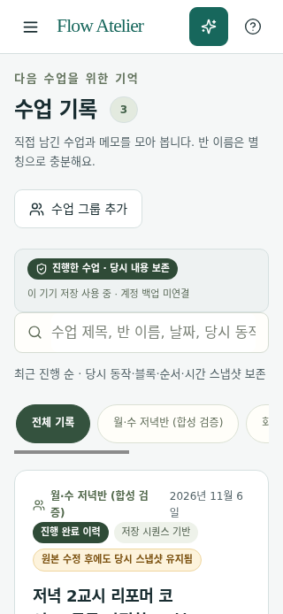 | 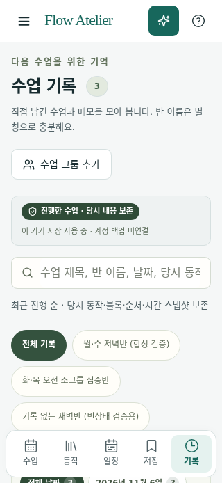 |
| **Mobile `390px`** | 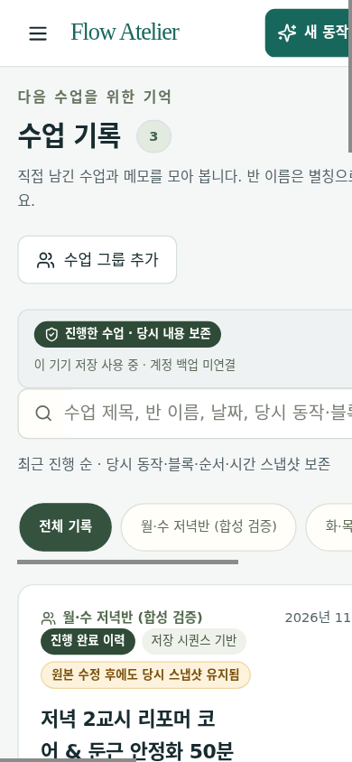 | 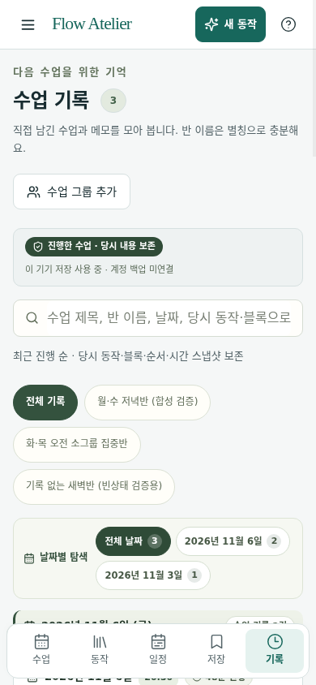 |
| **Tablet `768px`** | 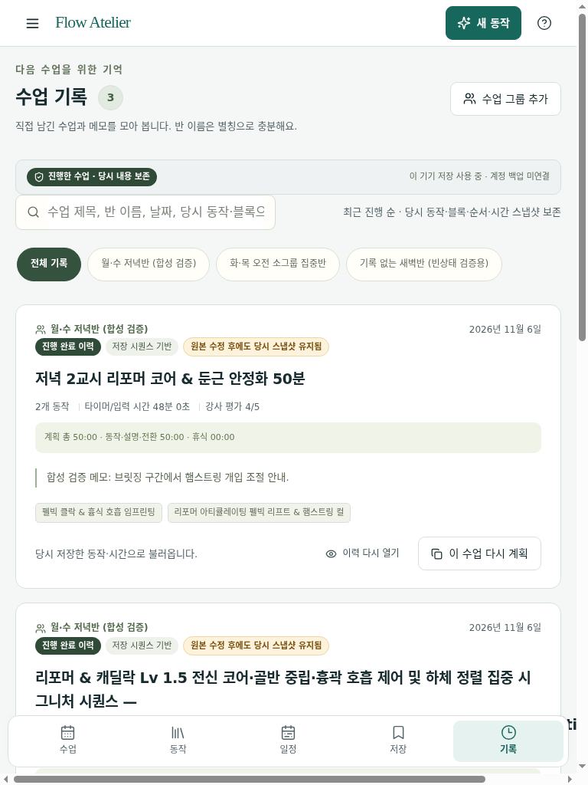 | 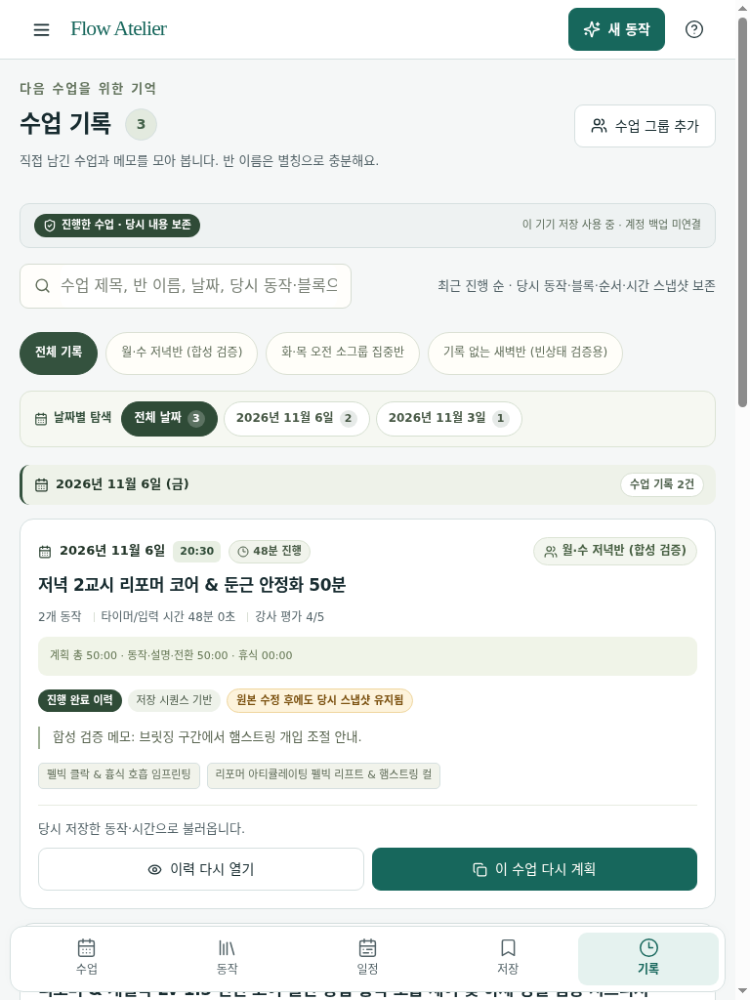 |
| **Desktop `1440px`** | 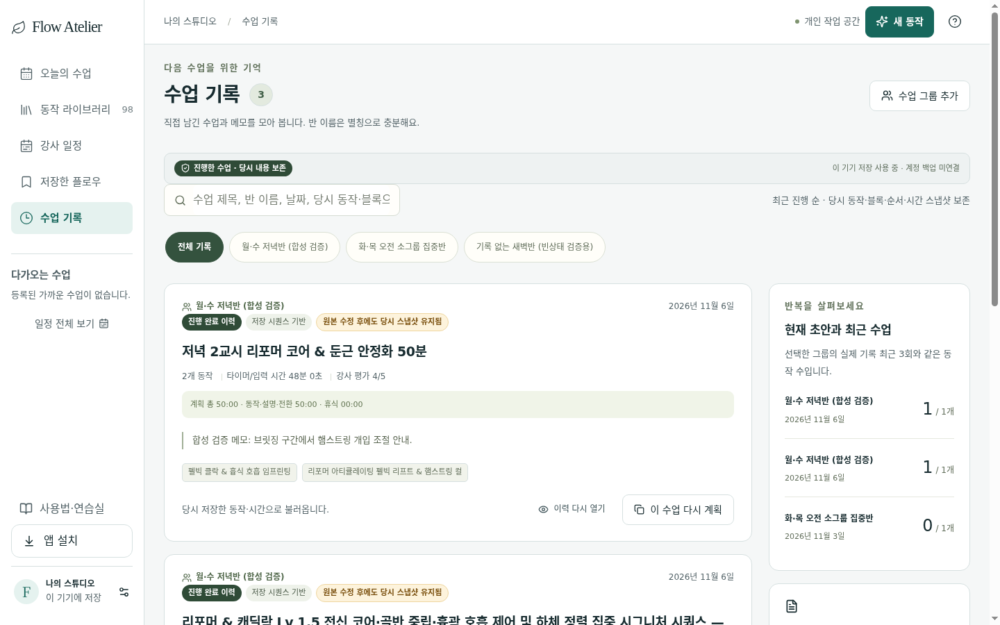 | 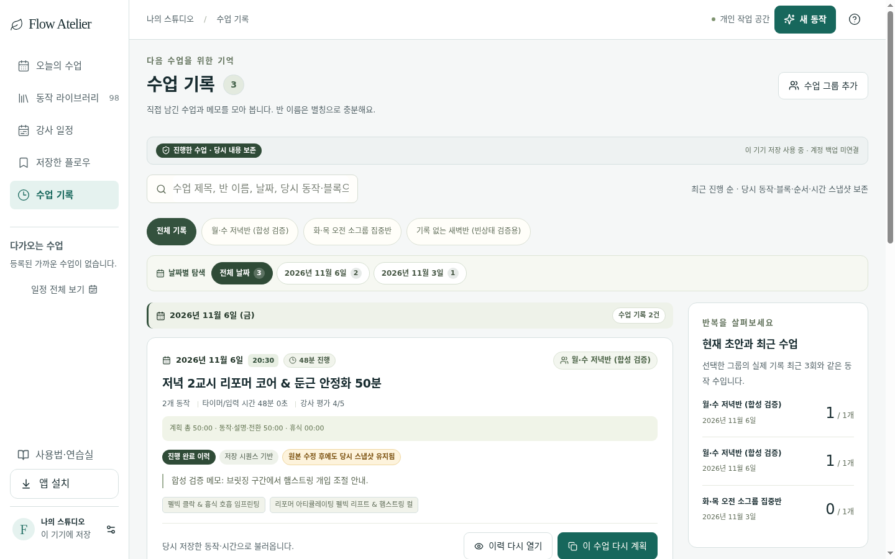 |
| **Desktop `1440px @ 200% Zoom`** | 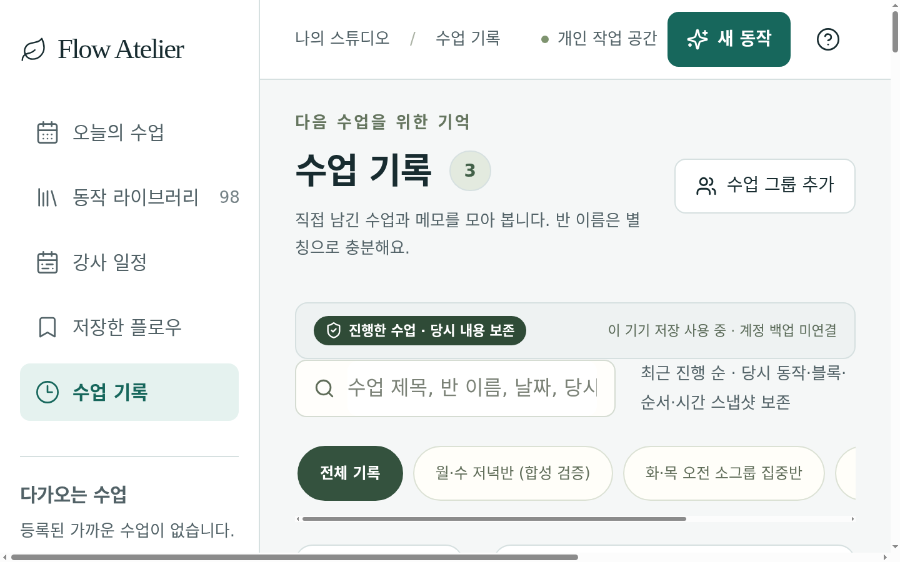 | 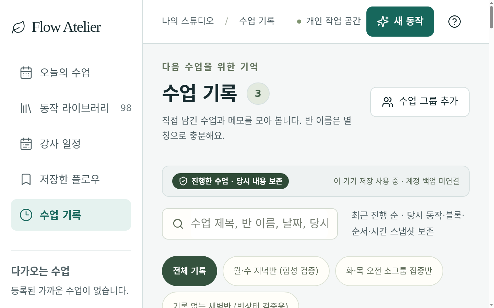 |
| **Mobile `390px @ 200% Zoom`** | 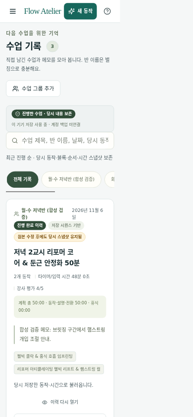 | 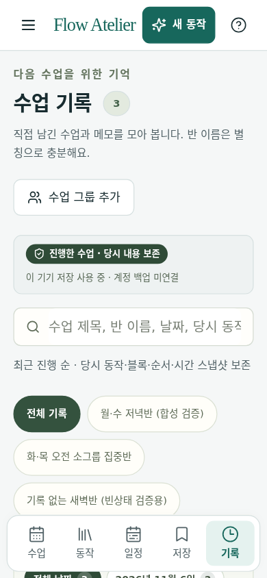 |
| **그룹 필터 빈 상태 (`390px`)** | 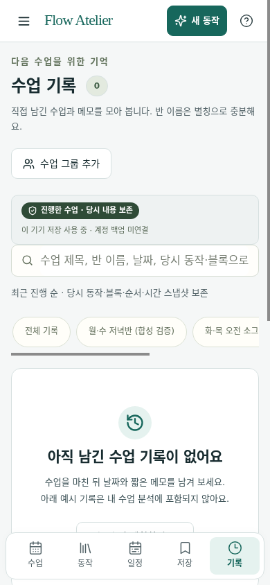 | 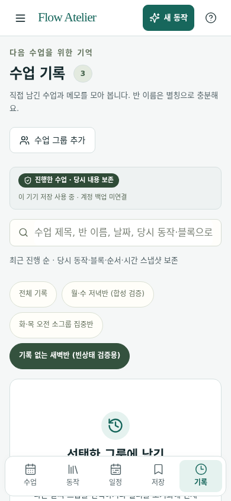 |
| **이력 상세 모달 (`320px`)** |  | 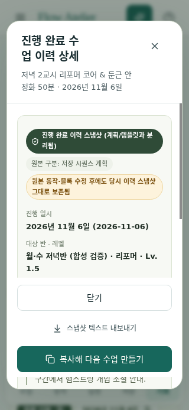 |

---

## 5. 재현 및 검증 명령 (Reproducibility Commands)

```bash
# 1. 타입 체크 및 린트 검증
pnpm exec tsc -b
pnpm lint

# 2. 수업 기록 페이지 신규/기존 기능 회귀 테스트
pnpm exec vitest run \
  src/components/ClassBinderView.historyFlow.test.tsx \
  src/components/ClassBinderView.storageStatus.test.tsx \
  src/test/teachingHistoryProgramRecord.test.tsx \
  src/test/teachingRecordPersistence.test.tsx \
  src/test/historyCopyCriteria.test.tsx \
  src/test/restBinder.test.tsx \
  src/test/designSystem.test.tsx

# 3. 실제 헤드리스 Chromium 브라우저 뷰포트·200% 확대·상호작용 검증
node docs/parallel-page-history-20261107/verify-history-page-browser.mjs --mode=after
```
